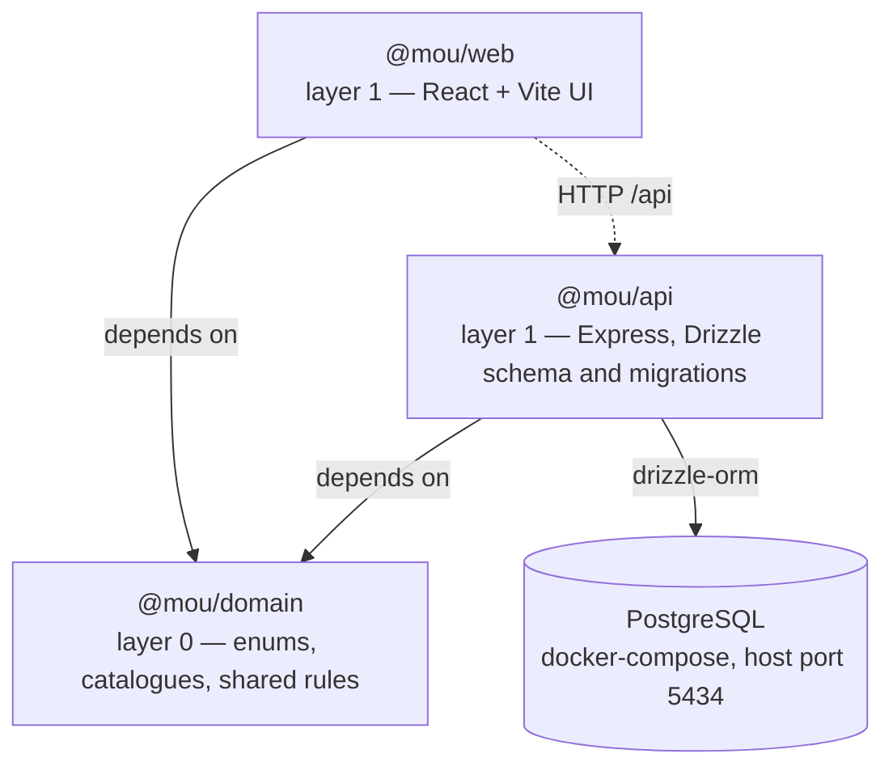
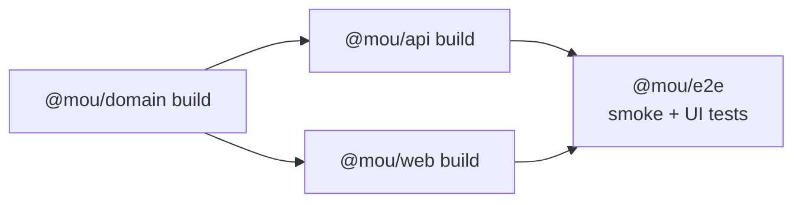

# Package design

Module/package layout of the MOU management system and the dependency direction
between packages. `ARCHITECTURE.md` requires modules to have acyclic dependencies,
higher layers to depend only on lower layers, and packages in the same layer never
to depend on each other.

## Layering

- **`@mou/domain`** is layer 0 and has zero runtime dependencies. It owns the
  master reference lists, the item catalogues and the shared derived rules. Both
  layer 1 packages may depend on it; it depends on nothing.
- **`@mou/api`** is layer 1. It owns the Drizzle schema, the generated migrations,
  the seeds and the HTTP API. It depends on `@mou/domain` and on PostgreSQL.
- **`@mou/web`** is layer 1. It owns the UI. It depends on `@mou/domain` and talks
  to `@mou/api` over HTTP. `@mou/api` and `@mou/web` never depend on each other, so
  the layering stays acyclic.
- **`@mou/e2e`** is a test-only workspace at the root; it is not part of the
  runtime layering.

## Build order

Turborepo enforces this through `dependsOn: ["^build"]` on the `test`,
`check-types`, `test:integration` and `test:ui` tasks.

## Test layers

| Layer | What it covers | Command | Cached |
|---|---|---|---|
| Unit | Pure logic — the `@mou/domain` rules and catalogues, and `@mou/api` password hashing. No database | `npm test` | Yes |
| Smoke | Workspace linking and the build-before-test ordering | `npm test` | Yes |
| Integration | `@mou/api` against docker-compose Postgres, driven over real HTTP | `npm run test:integration` | **No** |
| UI | Playwright against the real API and web dev servers | `npm run test:ui` | **No** |

Integration and UI are uncached because they assert against live state, where a
cached pass would be meaningless. Both need Docker running.

## Notes

- `@mou/api` is ESM (`"type": "module"`). Relative imports carry a `.ts` extension
  in source; `rewriteRelativeImportExtensions` rewrites them to `.js` in `dist`, so
  the same source runs both under `node --experimental-strip-types` and from the
  compiled output.
- `@mou/api` exposes one subpath export, `@mou/api/auth/password`, so the UI test
  fixtures can create accounts with real hashes without widening the service's main
  entry point.
- `@mou/e2e` uses bundler module resolution rather than the base config's NodeNext,
  because Playwright resolves extensionless relative imports at runtime.
- Turborepo resolves the package manager from the root `packageManager` field, so
  workspace tasks must be launched through `npm run <task>` rather than by invoking
  `turbo` directly.

