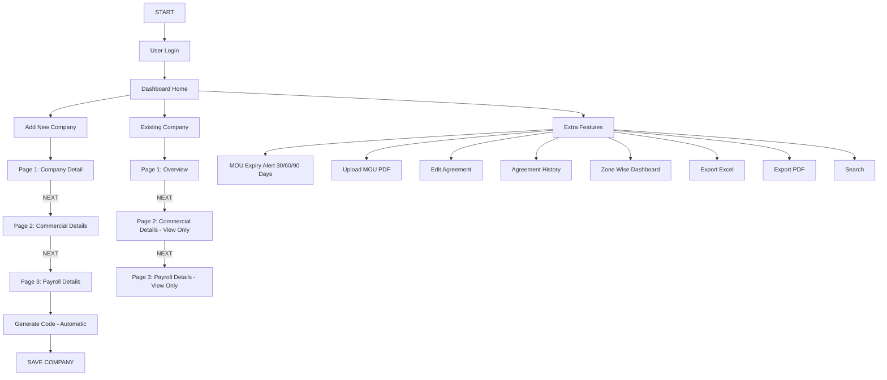
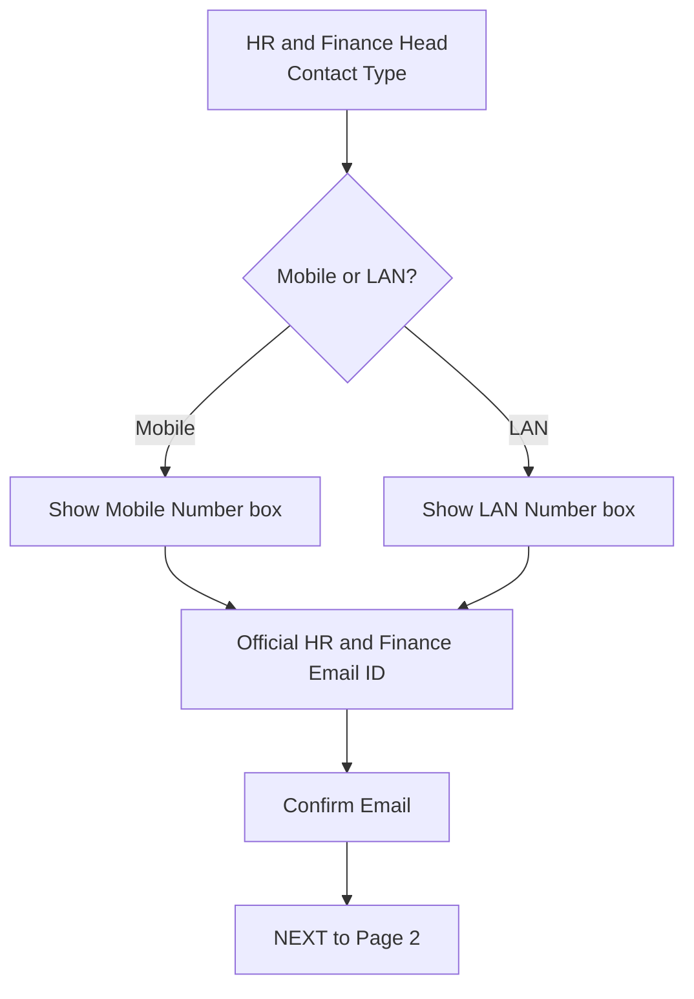
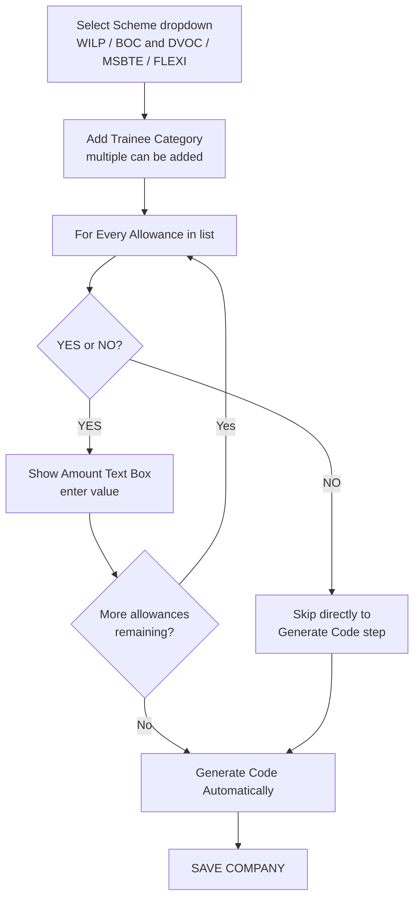
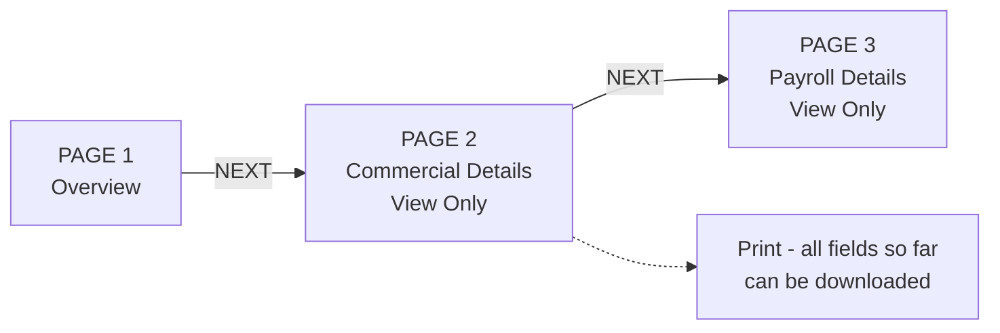
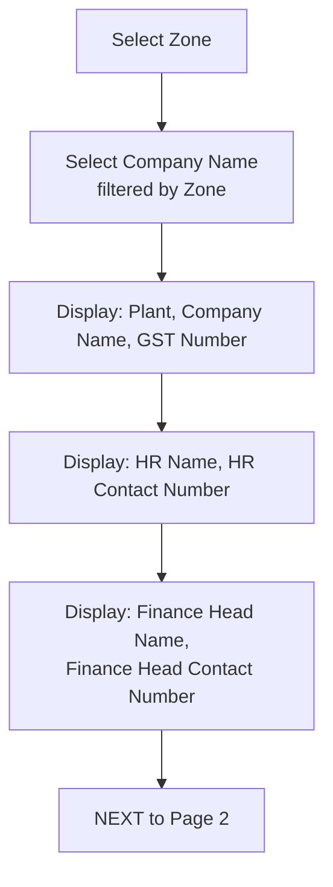
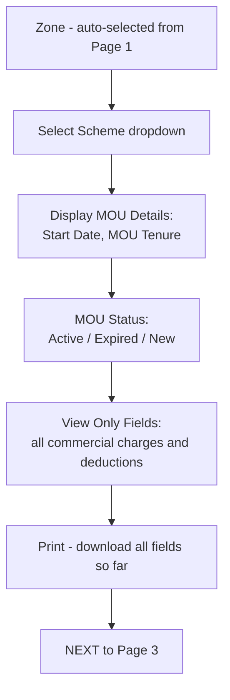
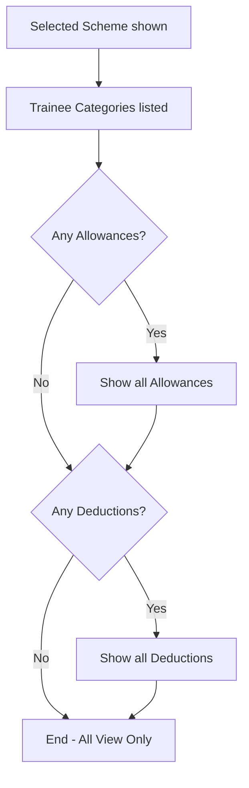
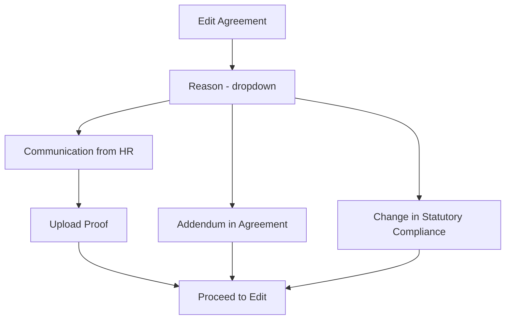
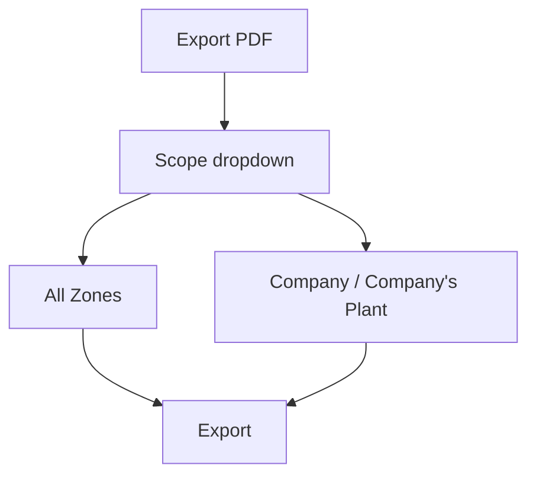
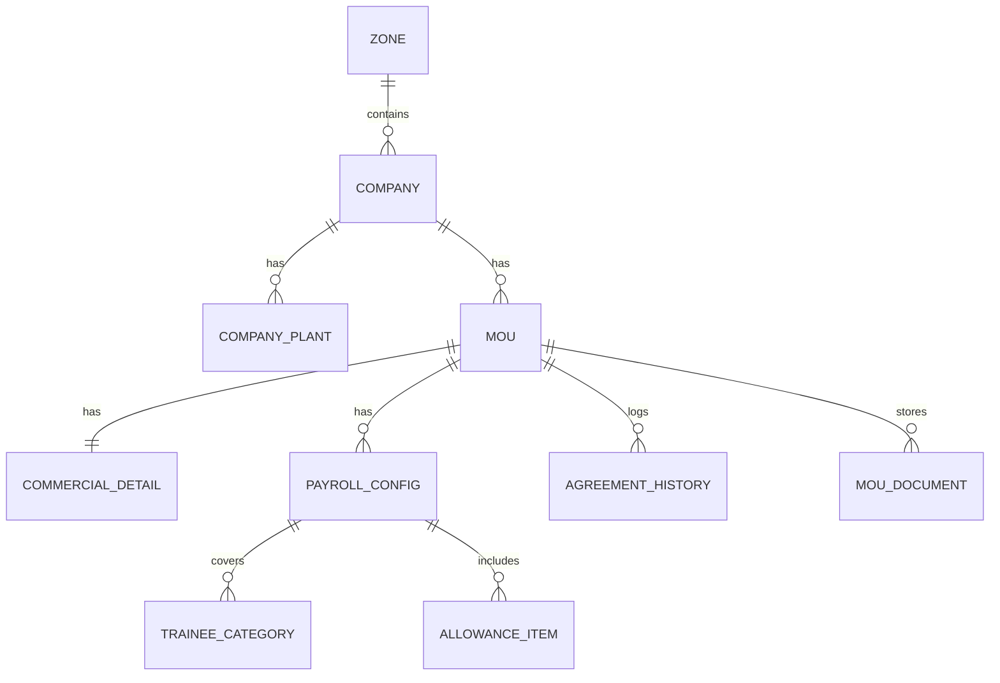

# Company / MOU Management - Complete Functional Specification

> **Purpose of this file:** This is the single source of truth for the Company / MOU Management web application. It consolidates 100% of the content from the Flow Diagram (`Final_MOU_FLOW.pdf`) and the Step-by-Step Documentation (`final_MOU_FLOW_Doccumentation.docx`) into one handoff document for a coding agent.
>
> **How to read it:** Sections 1 to 8 are the verified source requirements. Section 9 onwards is derived engineering guidance (data model, validation, API surface) clearly marked as INFERRED, so you can distinguish confirmed requirements from suggested implementation.

---

## Table of Contents

1. [Purpose and Scope](#1-purpose-and-scope)
2. [How the Flow is Organised](#2-how-the-flow-is-organised)
3. [Login and Dashboard](#3-login-and-dashboard)
4. [Add New Company - 3 Page Wizard](#4-add-new-company---3-page-wizard)
5. [Existing Company - 3 Page View Flow](#5-existing-company---3-page-view-flow)
6. [Extra Features on the Dashboard](#6-extra-features-on-the-dashboard)
7. [Quick Reference - Flow at a Glance](#7-quick-reference---flow-at-a-glance)
8. [Master Reference Lists](#8-master-reference-lists)
9. [INFERRED - Suggested Data Model](#9-inferred---suggested-data-model)
10. [INFERRED - Validation Rules](#10-inferred---validation-rules)
11. [INFERRED - Suggested API Surface](#11-inferred---suggested-api-surface)
12. [Open Questions and Ambiguities](#12-open-questions-and-ambiguities)

---

## 1. Purpose and Scope

This document walks through the Company / MOU Management module step by step, covering:

- Login
- The Add New Company wizard
- The Existing Company review flow
- The supporting Dashboard features

The application is a centralised web platform for onboarding companies, capturing MOU commercial terms, and configuring scheme-wise trainee payroll across zones and plants.

---

## 2. How the Flow is Organised

From the Dashboard, the user follows one of two paths:

- **Add New Company** - a 3-page data-entry wizard that creates a new company record.
- **Existing Company** - a 3-page view-only flow used to look up and review a company already created, along with its MOU / commercial / payroll data.

### 2.1 Top Level Flow



---

## 3. Login and Dashboard

| Step   | Action                                                                                                                                          |
| ------ | ----------------------------------------------------------------------------------------------------------------------------------------------- |
| Step 1 | User logs in with valid credentials.                                                                                                            |
| Step 2 | On successful login, the Dashboard Home screen opens.                                                                                           |
| Step 3 | From here the user chooses "Add New Company" or "Existing Company". The Dashboard also gives access to the Extra Features covered in Section 6. |

---

## 4. Add New Company - 3 Page Wizard

This is a 3-page wizard. Each page must be completed and confirmed with **"Next"** before the following page opens. **Nothing is saved until the code is generated at the end of Page 3.**


---

### 4.1 Page 1 - Company Details

| Step   | Action                                                                                                                                                                                                    | Field Type      |
| ------ | --------------------------------------------------------------------------------------------------------------------------------------------------------------------------------------------------------- | --------------- |
| Step 1 | Enter the Company Name.                                                                                                                                                                                   | Text            |
| Step 2 | Select **Company Type** from the dropdown. This classifies the company.                                                                                                                                   | Dropdown        |
| Step 3 | Select **Registration Type**.                                                                                                                                                                             | Dropdown        |
| Step 4 | Enter TAN Number and GST Number.                                                                                                                                                                          | Text            |
| Step 5 | Enter Zone and Company Plant.                                                                                                                                                                             | Text / Dropdown |
| Step 6 | Fill the address block: Address Line 1, Address Line 2, City, PIN Code, State, District.                                                                                                                  | Text            |
| Step 7 | Enter HR Contact Name and Finance Head Contact Name. These are the two people the system will keep in touch with for this company.                                                                        | Text            |
| Step 8 | Choose the **Contact Type** for HR and Finance: Mobile or LAN. Selecting Mobile opens a Mobile Number box; selecting LAN opens a LAN Number box instead. **This single choice applies to both contacts.** | Radio / Toggle  |
| Step 9 | Enter the Official HR and Finance Email ID, then Confirm Email to catch typing mistakes.                                                                                                                  | Email           |

**Company Type options:**

- Central Govt
- Central PSU
- Co-operative
- Private Sector
- State Govt
- State PSU

**Registration Type options:**

- Proprietorship
- Company
- Partnership
- HUF
- Trust
- Society
- Association
- Local Authority
- Others
- Government

**Complete Page 1 field list (in diagram order):**

1. Company Type (dropdown)
2. Company Name
3. Registration Type (dropdown)
4. TAN Number
5. GST Number
6. Zone
7. Company Plant
8. Address Line 1
9. Address Line 2
10. City
11. PIN Code
12. State
13. District
14. HR Contact Name
15. Finance Head Contact Name
16. HR and Finance Head Contact Type (Mobile No / LAN No)
17. Mobile No **OR** LAN No (conditional on #16)
18. Official HR and Finance Email ID
19. Confirm Email

**Contact Type conditional branch:**



Once every field is correct, **"Next"** moves to Page 2.

---

### 4.2 Page 2 - Commercial Details

| Step   | Action                                                                                                                          |
| ------ | ------------------------------------------------------------------------------------------------------------------------------- |
| Step 1 | Enter the **MOU Start Date**.                                                                                                   |
| Step 2 | Enter the **MOU Tenure**. This defines how long the agreement runs from the start date. **No separate End Date field is used.** |
| Step 3 | Upload the signed MOU as a **PDF**.                                                                                             |
| Step 4 | Set the **Attendance Cycle** and **Stipend Date**, which control how often trainees are paid.                                   |
| Step 5 | Enter every applicable charge / deduction (full list below).                                                                    |

**Complete Page 2 field list (in diagram order):**

1. MOU Start Date
2. MOU Tenure
3. Upload MOU PDF
4. Attendance Cycle
5. Stipend Date
6. Admin Charges
7. Insurance
8. Shoes and Uniform
9. Supervisor Charges
10. Sourcing Charges
11. Education Charges
12. Training Charges
13. Assessment Charges
14. One Time Registration Fees
15. Canteen Deduction
16. Coupon Amount
17. Document Fee
18. Joining Fee
19. Left Deduction
20. Skill Diploma Fees
21. Transportation Deduction
22. **Other** - in this field enter any additional allowance or deduction here with amount

> **Note on "Other":** This is a free-form entry where the user types a custom allowance or deduction label along with its amount. It must support at minimum one label + amount pair; ideally repeatable rows.

Once completed, **"Next"** moves to Page 3.

---

### 4.3 Page 3 - Payroll Details

| Step   | Action                                                                                                                                                                                                          |
| ------ | --------------------------------------------------------------------------------------------------------------------------------------------------------------------------------------------------------------- |
| Step 1 | Select the **Scheme** from the dropdown: WILP, BOC and DVOC, MSBTE, or FLEXI.                                                                                                                                   |
| Step 2 | **Add Trainee Category.** More than one category can be added under the same scheme.                                                                                                                            |
| Step 3 | For every payroll item in the list, decide **Yes** or **No**. **Yes** opens an amount box; enter the value for that item. **No** skips the item and the flow moves straight ahead without asking for an amount. |
| Step 4 | Once every item has been answered, the system **automatically generates a Code** for the company.                                                                                                               |
| Step 5 | The record is then **saved**. This completes the Add New Company flow.                                                                                                                                          |

**Scheme dropdown options:**

- WILP
- BOC and DVOC
- MSBTE
- FLEXI

**Payroll / Allowance items (Yes/No + amount for each):**

1. Attendance Bonus
2. 1st Year Allowance
3. 2nd Year Allowance
4. 3rd Year Allowance
5. Accommodation Allowance
6. Arrears
7. Bonus
8. Canteen Allowance
9. Conveyance
10. Document Fee
11. Education Allowance
12. Ex-Gratia
13. Foundry Allowance
14. Leave Encashment
15. Leave With Wages
16. Night Shift Allowance
17. Reimbursement of Education Charges
18. Special Allowance
19. Registration Fee
20. Travelling Allowance
21. Uniform Refund
22. Washing Allowance
23. **Other** - enter any additional allowance or deduction here with amount

**Page 3 conditional logic:**



> **Diagram note:** The source flow diagram labels the NO branch as "Skip directly to Generate Code step." Read this as: a NO answer skips the amount box for that item, not that it aborts the remaining items. Confirm with the business owner if a global skip is intended (see Section 12).

---

## 5. Existing Company - 3 Page View Flow

This flow is **for review only**. Every field shown here is **view-only**. It follows the same three stages as Add New Company, but displays information that was already captured.



---

### 5.1 Page 1 - Overview

| Step   | Action                                                                                                                     |
| ------ | -------------------------------------------------------------------------------------------------------------------------- |
| Step 1 | Select a **Zone**.                                                                                                         |
| Step 2 | Select the **Company Name** that belongs to that zone.                                                                     |
| Step 3 | The system displays the company's Plant, GST Number, HR Name and Contact Number, and Finance Head Name and Contact Number. |

**Displayed fields:**

- Plant
- Company Name
- GST Number
- HR Name
- HR Contact Number
- Finance Head Name
- Finance Head Contact Number



---

### 5.2 Page 2 - Commercial Details (View Only)

| Step   | Action                                                                                                                                                                |
| ------ | --------------------------------------------------------------------------------------------------------------------------------------------------------------------- |
| Step 1 | **Zone** carries over automatically from Page 1 (auto-selected).                                                                                                      |
| Step 2 | Select a **Scheme** from the dropdown: WILP, BOC and DVOC, FLEXI, or MSBTE. **Each company can run more than one scheme**, so this choice decides which MOU is shown. |
| Step 3 | The system displays that scheme's **MOU Start Date** and **MOU Tenure**.                                                                                              |
| Step 4 | **MOU Status** is shown as **Active**, **Expired**, or **New**, so the user can immediately see if renewal is needed.                                                 |
| Step 5 | All commercial fields captured during Add New Company are shown, **strictly view-only**.                                                                              |
| Step 6 | A **Print** option is available here. Everything shown up to this point can be downloaded before moving on.                                                           |

**View-only fields displayed on this page:**

Attendance Cycle, Stipend Date, Admin Charges, Insurance, Shoes and Uniform, Supervisor Charges, Sourcing Charges, Education Charges, Training Charges, Assessment Charges, One Time Registration Fee, Canteen Deduction, Coupon Amount, Transportation Deduction, Document Fee, Joining Fee, Left Deduction, Skill Diploma Fees, and the remaining charges / deductions.

**MOU Status values:** `Active` | `Expired` | `New`



Clicking **"Next"** moves to Page 3.

---

### 5.3 Page 3 - Payroll Details (View Only)

| Step   | Action                                                                           |
| ------ | -------------------------------------------------------------------------------- |
| Step 1 | The **Scheme** selected on Page 2 is shown.                                      |
| Step 2 | **Trainee Categories** under that scheme are listed.                             |
| Step 3 | If any **Allowances** were configured for this company, they are displayed here. |
| Step 4 | If any **Deductions** were configured, they are displayed here as well.          |

**Everything on this page is view-only.**



---

## 6. Extra Features on the Dashboard

Beyond the two main flows, the Dashboard gives access to the following supporting tools:

1. MOU Expiry Alert (30/60/90 Days)
2. Upload MOU PDF
3. Edit Agreement
4. Agreement History
5. Zone Wise Dashboard
6. Export Excel
7. Export PDF
8. Search

---

### 6.1 MOU Expiry Alert

Automatically warns the user **30, 60, or 90 days** before an MOU is due to expire, so renewal can be planned in time.

---

### 6.2 Upload MOU PDF

This is a guided, four-step path rather than a single button:

| Step   | Action                       |
| ------ | ---------------------------- |
| Step 1 | Select **Zone**.             |
| Step 2 | Select **Company**.          |
| Step 3 | Select **Company Plant**.    |
| Step 4 | **Upload** the MOU PDF here. |


---

### 6.3 Edit Agreement

Editing an agreement requires the user to **first state a Reason** from a dropdown:

| Reason                             | Behaviour                                                     |
| ---------------------------------- | ------------------------------------------------------------- |
| **Communication from HR**          | User must also **upload supporting proof** before proceeding. |
| **Addendum in Agreement**          | Proceeds directly to the edit.                                |
| **Change in Statutory Compliance** | Proceeds directly to the edit.                                |



---

### 6.4 Agreement History

Keeps a record of **past versions of an agreement**, useful for audit or reference.

---

### 6.5 Zone Wise Dashboard

Gives a summarised view of companies and MOUs **grouped by Zone**.

---

### 6.6 Export Excel

Downloads the company / MOU data in **Excel format**.

---

### 6.7 Export PDF

Before exporting, the user picks the **scope from a dropdown**:

| Scope                         | Behaviour                                   |
| ----------------------------- | ------------------------------------------- |
| **All Zones**                 | Exports data across every zone.             |
| **Company / Company's Plant** | Exports data for a single selected company. |



---

### 6.8 Search

Quickly locate a record by **Company**, **Plant**, or **Scheme**.

**Search By options:**

- Company
- Plant
- Scheme

---

## 7. Quick Reference - Flow at a Glance

| Stage                  | What Happens                                                                                                                                                                                                                 |
| ---------------------- | ---------------------------------------------------------------------------------------------------------------------------------------------------------------------------------------------------------------------------- |
| **Login to Dashboard** | User authenticates and lands on the home screen with two options.                                                                                                                                                            |
| **Add New Company**    | Page 1 (Company Details, incl. HR and Finance contact) to Page 2 (Commercial - MOU Start + Tenure) to Page 3 (Payroll - Scheme, Trainee Category, Yes/No allowances) to Generate Code to Save.                               |
| **Existing Company**   | Zone to Company (Page 1 Overview) to Page 2 (Commercial, scheme-wise, view-only, with Print) to Page 3 (Payroll, view-only, conditional Allowances/Deductions).                                                              |
| **Extra Features**     | MOU Expiry Alert; Upload MOU PDF (Zone to Company to Plant to Upload); Edit Agreement (reason-based); Agreement History; Zone-wise Dashboard; Export Excel; Export PDF (All Zones / Company); Search (Company/Plant/Scheme). |

---

## 8. Master Reference Lists

### 8.1 Company Type

`Central Govt` | `Central PSU` | `Co-operative` | `Private Sector` | `State Govt` | `State PSU`

### 8.2 Registration Type

`Proprietorship` | `Company` | `Partnership` | `HUF` | `Trust` | `Society` | `Association` | `Local Authority` | `Others` | `Government`

### 8.3 Contact Type

`Mobile No` | `LAN No`

### 8.4 Scheme

`WILP` | `BOC and DVOC` | `MSBTE` | `FLEXI`

### 8.5 MOU Status

`Active` | `Expired` | `New`

### 8.6 MOU Expiry Alert Thresholds

`30 Days` | `60 Days` | `90 Days`

### 8.7 Edit Agreement Reasons

`Communication from HR` (requires proof upload) | `Addendum in Agreement` | `Change in Statutory Compliance`

### 8.8 Export PDF Scope

`All Zones` | `Company / Company's Plant`

### 8.9 Search By

`Company` | `Plant` | `Scheme`

### 8.10 Commercial Charges and Deductions (Page 2)

| #   | Item                          |
| --- | ----------------------------- |
| 1   | Admin Charges                 |
| 2   | Insurance                     |
| 3   | Shoes and Uniform             |
| 4   | Supervisor Charges            |
| 5   | Sourcing Charges              |
| 6   | Education Charges             |
| 7   | Training Charges              |
| 8   | Assessment Charges            |
| 9   | One Time Registration Fees    |
| 10  | Canteen Deduction             |
| 11  | Coupon Amount                 |
| 12  | Document Fee                  |
| 13  | Joining Fee                   |
| 14  | Left Deduction                |
| 15  | Skill Diploma Fees            |
| 16  | Transportation Deduction      |
| 17  | Other (custom label + amount) |

### 8.11 Payroll Allowances (Page 3)

| #   | Item                               |
| --- | ---------------------------------- |
| 1   | Attendance Bonus                   |
| 2   | 1st Year Allowance                 |
| 3   | 2nd Year Allowance                 |
| 4   | 3rd Year Allowance                 |
| 5   | Accommodation Allowance            |
| 6   | Arrears                            |
| 7   | Bonus                              |
| 8   | Canteen Allowance                  |
| 9   | Conveyance                         |
| 10  | Document Fee                       |
| 11  | Education Allowance                |
| 12  | Ex-Gratia                          |
| 13  | Foundry Allowance                  |
| 14  | Leave Encashment                   |
| 15  | Leave With Wages                   |
| 16  | Night Shift Allowance              |
| 17  | Reimbursement of Education Charges |
| 18  | Special Allowance                  |
| 19  | Registration Fee                   |
| 20  | Travelling Allowance               |
| 21  | Uniform Refund                     |
| 22  | Washing Allowance                  |
| 23  | Other (custom label + amount)      |

---

## 9. INFERRED - Suggested Data Model

> Everything from here down is engineering guidance derived from the source documents, not stated requirements. Validate before building.

### 9.1 Entity Relationship Overview



### 9.2 Tables

**`zone`**
| Column | Type | Notes |
|---|---|---|
| id | PK | |
| name | string | unique |

**`company`**
| Column | Type | Notes |
|---|---|---|
| id | PK | |
| generated_code | string | auto-generated at end of Page 3, unique |
| company_name | string | required |
| company_type | enum | see 8.1 |
| registration_type | enum | see 8.2 |
| tan_number | string | |
| gst_number | string | |
| zone_id | FK to zone | |
| address_line_1 | string | |
| address_line_2 | string | nullable |
| city | string | |
| pin_code | string | |
| state | string | |
| district | string | |
| hr_contact_name | string | |
| finance_head_contact_name | string | |
| contact_type | enum | `MOBILE` or `LAN`, applies to both contacts |
| hr_contact_number | string | |
| finance_head_contact_number | string | |
| official_email | string | |
| created_at / updated_at | timestamp | |

**`company_plant`**
| Column | Type | Notes |
|---|---|---|
| id | PK | |
| company_id | FK | |
| plant_name | string | |

> Page 1 captures a single "Company Plant" field, but Existing Company and Upload MOU PDF both let you pick a plant from a list. Model as a child table to allow multiple plants per company.

**`mou`**
| Column | Type | Notes |
|---|---|---|
| id | PK | |
| company_id | FK | |
| company_plant_id | FK | nullable |
| scheme | enum | see 8.4 |
| mou_start_date | date | |
| mou_tenure | int + unit | e.g. 24 months. No end date field is captured; compute end date. |
| status | enum | derived: `Active` / `Expired` / `New` |
| version | int | for Agreement History |
| created_at / updated_at | timestamp | |

> A company can run more than one scheme, so `mou` is one-to-many from `company` and keyed by scheme.

**`mou_document`**
| Column | Type | Notes |
|---|---|---|
| id | PK | |
| mou_id | FK | |
| file_path | string | PDF only |
| uploaded_at | timestamp | |
| uploaded_by | FK to user | |

**`commercial_detail`**
| Column | Type | Notes |
|---|---|---|
| id | PK | |
| mou_id | FK | |
| attendance_cycle | string | |
| stipend_date | int or date | |
| admin_charges | decimal | |
| insurance | decimal | |
| shoes_and_uniform | decimal | |
| supervisor_charges | decimal | |
| sourcing_charges | decimal | |
| education_charges | decimal | |
| training_charges | decimal | |
| assessment_charges | decimal | |
| one_time_registration_fees | decimal | |
| canteen_deduction | decimal | |
| coupon_amount | decimal | |
| document_fee | decimal | |
| joining_fee | decimal | |
| left_deduction | decimal | |
| skill_diploma_fees | decimal | |
| transportation_deduction | decimal | |

**`commercial_other_item`** (for the "Other" free-form field)
| Column | Type | Notes |
|---|---|---|
| id | PK | |
| commercial_detail_id | FK | |
| label | string | user-entered |
| amount | decimal | |
| item_type | enum | `ALLOWANCE` or `DEDUCTION` |

**`payroll_config`**
| Column | Type | Notes |
|---|---|---|
| id | PK | |
| mou_id | FK | |
| scheme | enum | mirrors mou.scheme |

**`trainee_category`**
| Column | Type | Notes |
|---|---|---|
| id | PK | |
| payroll_config_id | FK | |
| category_name | string | multiple per config |

**`allowance_item`**
| Column | Type | Notes |
|---|---|---|
| id | PK | |
| payroll_config_id | FK | |
| item_key | enum | one of the 23 items in 8.11 |
| custom_label | string | only when item_key = OTHER |
| is_applicable | boolean | the Yes/No answer |
| amount | decimal | null when is_applicable = false |
| item_type | enum | `ALLOWANCE` or `DEDUCTION` |

**`agreement_history`**
| Column | Type | Notes |
|---|---|---|
| id | PK | |
| mou_id | FK | |
| version | int | |
| edit_reason | enum | see 8.7 |
| proof_file_path | string | required when reason = Communication from HR |
| snapshot | JSON | full prior state of the MOU |
| edited_by | FK to user | |
| edited_at | timestamp | |

**`user`**
| Column | Type | Notes |
|---|---|---|
| id | PK | |
| username / email | string | |
| password_hash | string | |
| role | enum | roles not specified in source; see Section 12 |

---

## 10. INFERRED - Validation Rules

### 10.1 Page 1

- Company Name: required, trimmed, no duplicate within the same Zone + Plant combination.
- Company Type and Registration Type: required, must match enum.
- TAN Number: 10 characters, format `AAAA99999A` (4 letters, 5 digits, 1 letter).
- GST Number: 15 characters, format `99AAAAA9999A9A9`. State code in the first 2 digits should reconcile with the State field.
- PIN Code: exactly 6 digits, numeric.
- Mobile No: 10 digits when contact_type = MOBILE.
- LAN No: numeric with optional STD code separator when contact_type = LAN.
- Official Email and Confirm Email: valid email format, must match exactly, case-insensitive comparison.
- Address Line 1, City, State, District: required. Address Line 2 optional.

### 10.2 Page 2

- MOU Start Date: required, valid date. Flag if backdated more than a configurable threshold.
- MOU Tenure: required, positive integer with unit (months or years). Derived end date = start_date + tenure.
- MOU PDF: required, mime type `application/pdf` only, size cap (suggest 10 MB), virus scan if available.
- Attendance Cycle: required.
- Stipend Date: required, valid day of month (1 to 31).
- All charge and deduction fields: numeric, non-negative, 2 decimal places. Empty should persist as 0 or null, decide and be consistent.
- "Other" rows: if a label is entered, an amount becomes mandatory and vice versa.

### 10.3 Page 3

- Scheme: required.
- At least one Trainee Category must be added before proceeding.
- Every one of the 23 allowance items must have an explicit Yes or No. No item may be left unanswered.
- When Yes: amount is required, numeric, non-negative.
- When No: amount field is hidden and stored as null.
- "Other": custom label required when the item is answered Yes.
- Generate Code fires only after all items are answered. Code must be unique and non-editable.

### 10.4 Wizard-level

- **Nothing persists to the main tables until Save on Page 3.** Hold in-progress state in a draft table or client-side session so a browser refresh does not wipe the wizard.
- Back navigation between pages should preserve entered data.
- Next button remains disabled until the current page passes validation.

### 10.5 MOU Status derivation

```
end_date = mou_start_date + mou_tenure

if today < mou_start_date            -> New
else if today <= end_date            -> Active
else                                 -> Expired
```

### 10.6 Expiry Alert logic

```
days_remaining = end_date - today

if days_remaining in (90, 60, 30)    -> trigger alert
```

Run as a scheduled daily job. Alert recipients should be the HR and Finance Head contacts on file plus the logged-in admin. Confirm delivery channel (in-app, email, or both) with the business owner.

---

## 11. INFERRED - Suggested API Surface

### Auth

| Method | Endpoint           | Purpose           |
| ------ | ------------------ | ----------------- |
| POST   | `/api/auth/login`  | Authenticate user |
| POST   | `/api/auth/logout` | End session       |

### Master Data

| Method | Endpoint                        | Purpose                                                    |
| ------ | ------------------------------- | ---------------------------------------------------------- |
| GET    | `/api/zones`                    | List all zones                                             |
| GET    | `/api/zones/{zoneId}/companies` | Companies in a zone (Existing Company Page 1)              |
| GET    | `/api/companies/{id}/plants`    | Plants for a company                                       |
| GET    | `/api/enums`                    | Company types, registration types, schemes, allowance list |

### Add New Company Wizard

| Method | Endpoint                         | Purpose                                            |
| ------ | -------------------------------- | -------------------------------------------------- |
| POST   | `/api/companies/draft`           | Create or update wizard draft                      |
| GET    | `/api/companies/draft/{draftId}` | Resume a draft                                     |
| POST   | `/api/companies`                 | Final submit, generates code and saves all 3 pages |

### Existing Company

| Method | Endpoint                       | Purpose                                   |
| ------ | ------------------------------ | ----------------------------------------- |
| GET    | `/api/companies/{id}/overview` | Page 1 data                               |
| GET    | `/api/companies/{id}/mous`     | Available schemes for the scheme dropdown |
| GET    | `/api/mous/{mouId}/commercial` | Page 2 view data incl. status             |
| GET    | `/api/mous/{mouId}/payroll`    | Page 3 view data                          |
| GET    | `/api/mous/{mouId}/print`      | Print / download of Pages 1 and 2         |

### Extra Features

| Method | Endpoint                                              | Purpose                                           |
| ------ | ----------------------------------------------------- | ------------------------------------------------- |
| GET    | `/api/alerts/expiring?days=30\|60\|90`                | Expiry alert feed                                 |
| POST   | `/api/mous/{mouId}/document`                          | Upload MOU PDF                                    |
| POST   | `/api/mous/{mouId}/edit-request`                      | Submit edit reason + optional proof, unlocks edit |
| PUT    | `/api/mous/{mouId}`                                   | Apply the edit, writes an agreement_history row   |
| GET    | `/api/mous/{mouId}/history`                           | Agreement History                                 |
| GET    | `/api/dashboard/zone-wise`                            | Zone Wise Dashboard aggregates                    |
| GET    | `/api/export/excel`                                   | Export Excel                                      |
| GET    | `/api/export/pdf?scope=all_zones\|company&companyId=` | Export PDF                                        |
| GET    | `/api/search?by=company\|plant\|scheme&q=`            | Search                                            |

---

## 12. Open Questions and Ambiguities

These need a decision from the business owner before or during build. Do not guess silently.

1. **"Skip directly to Generate Code" on the NO branch.** The diagram wording is ambiguous. Does answering No to one allowance skip only that item's amount box, or does it jump past all remaining allowances straight to Generate Code? The documentation text supports per-item skip. Confirm.
2. **Code generation format.** The source says a Code is generated automatically but never defines the format. Suggest a readable composite such as `ZONE-COMPANY-SCHEME-SEQ`, but this needs sign-off.
3. **MOU Tenure unit.** Months or years? The field must carry a unit or the end date cannot be computed.
4. **Allowance vs Deduction classification.** Existing Company Page 3 splits the display into Allowances and Deductions, but Add New Company Page 3 captures everything as one flat list. A mapping is required to decide which of the 23 items renders under which heading.
5. **Zone as free text or master list.** Page 1 appears to accept Zone as an entry field, but Existing Company and Upload MOU PDF both use a Zone dropdown. Standardise on a Zone master table.
6. **Multiple plants per company.** Page 1 captures one plant. Other flows imply a plant list. Confirm whether one company record equals one plant, or one company can hold many.
7. **User roles and permissions.** Not specified anywhere in the source. Who can add, who can only view, who can approve an edit?
8. **Edit Agreement scope.** Which fields become editable after the reason is accepted? All three pages, or commercial terms only?
9. **Delivery channel for expiry alerts.** In-app banner, email, or both?
10. **Print on Existing Company Page 2** covers "all fields so far." Confirm this means Page 1 plus Page 2, and whether Page 3 payroll data should be included in a separate print.
11. **Duplicate prevention.** What makes a company unique? GST Number, TAN Number, or Company Name plus Plant?
12. **The "Other" field.** Single row or repeatable rows? The wording implies multiple additional items may need capturing.

---

## Appendix A - Source Traceability

| Source Document                      | What it contributed                                                                                                                              |
| ------------------------------------ | ------------------------------------------------------------------------------------------------------------------------------------------------ |
| `Final_MOU_FLOW.pdf`                 | Flow diagram: node sequence, branch conditions, exact field ordering, dropdown option lists, Extra Features layout, view-only field enumeration. |
| `final_MOU_FLOW_Doccumentation.docx` | Narrative step-by-step wording, purpose statements, per-step explanations, Quick Reference table, Section 6 feature descriptions.                |

**Reconciled discrepancies:**

- The PDF renders some labels truncated (`GST Numbe`, `FLE`, `Assessment Charge`). These are read as `GST Number`, `FLEXI`, and `Assessment Charges` respectively, matching the docx.
- The PDF lists `One Time Registration Fee` in the view-only block and `One Time Registration Fees` in the entry block. Treated as the same field.
- The docx lists Page 2 charges in prose and the PDF lists them as discrete nodes. The PDF node list is used as the authoritative field order.
- Export PDF scope is labelled `All Zones / Company` in the PDF and `All Zones / Company's plant` in the docx. Both refer to the same single-company scope option.
