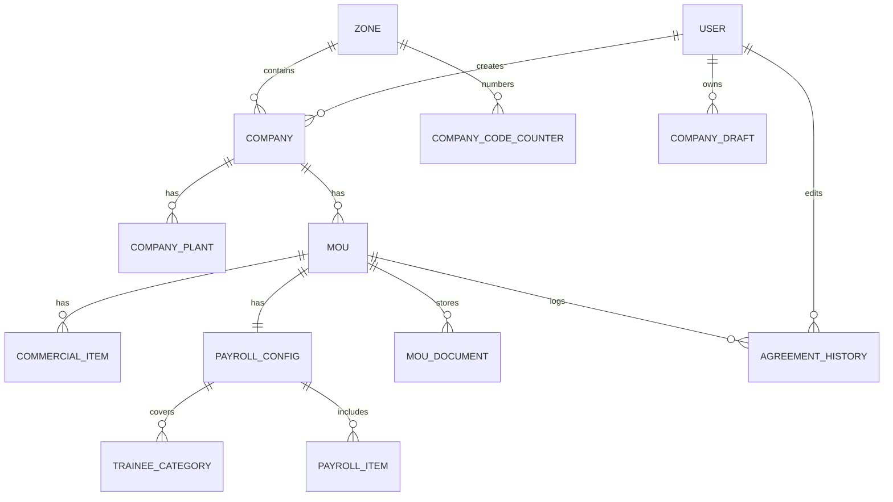

# SPEC-01 — Foundation and Master Data

**Depends on:** nothing. This is the first spec to implement.
**Source:** `docs/project_information.md` §2, §8, §9, §10.5
**Status:** technical decisions resolved (see §0). Two items blocked on the client — §12.

Everything else in this system references the enums, master tables and shared
rules defined here. Implement this first; every later spec assumes it exists.

---

## 0. Resolved technical decisions

Settled during design review. These were not in the source document and are not
open for rediscovery mid-build — they belong in `docs/design/ADR.md`.

| # | Decision | Choice | Rationale |
|---|---|---|---|
| D1 | Persistence | **PostgreSQL** | §5 is relational; SPEC-03 §4 needs one transaction across 8 tables, and the code sequence needs atomicity |
| D2 | Data access | **Drizzle ORM** + `drizzle-kit` migrations | Schema is TypeScript, types flow to `@mou/api`, generates plain SQL, no engine binary |
| D3 | Module layout | `@mou/domain` (layer 0) → `@mou/api` / `@mou/web` (layer 1) | Satisfies the ARCHITECTURE.md acyclic layering rule; §6 rules stay unit-testable with no database |
| D4 | MOU versioning | One live `mou` row, mutated in place; prior states as JSON in `agreement_history` | `is_current` would be true for every row that ever exists — a dead column every query must remember |
| D5 | End date | `start + tenure − 1 day`, Postgres **generated column** | A 12-month MOU from 1 Jan ends 31 Dec, not 1 Jan next year; generated means it cannot drift |
| D6 | Business clock | Fixed **Asia/Kolkata** | Status and alert thresholds must not shift by 5½ hours based on server locale |
| D7 | Code sequence | Counter table, **gaps allowed for now** | See §6.3 and Q13 — gap-free is a one-line change, pending client confirmation |
| D8 | Charge storage | Commercial charges are **rows**, same shape as payroll items | One renderer and one exporter instead of two; a new charge is a seed row, not a migration |
| D9 | Primary keys | **UUID v4**, `gen_random_uuid()` | Generatable before insert (SPEC-03 draft assembly); no record-count leakage in URLs |
| D10 | Money | `NUMERIC(12,2)` in DB, **string** in TypeScript | Exact storage, and no spec performs arithmetic on money — so no float risk and no decimal library |
| D11 | Enum storage | `varchar` + **CHECK constraint**; TS union is source of truth | Scheme and the role set may still change; altering a CHECK is an ordinary transactional migration |
| D12 | Deletion | **Soft delete** (`is_active`); all FKs `ON DELETE RESTRICT` | History and exports must always resolve; a bad reference should fail loudly, not erase children |
| D13 | Testing | §6 rules unit-tested with no DB; schema constraints tested against docker-compose Postgres, **uncached** | AC1/AC3/AC5 are assertions about Postgres and cannot be proven without it |

---

## 1. Scope

- The full persistent data model (§5) as a Drizzle schema plus generated migrations.
- The master reference lists (§2–§4) and how they are served to the UI (§7).
- Zone and Plant master data, with a provisional zone seed (§11).
- Shared derived rules: MOU end date, MOU status, generated company code (§6).
- The `@mou/domain` workspace package, created by this spec.

**Out of scope:** any screen; any API beyond the master lookups in §7; login,
sessions and password hashing (SPEC-02). This spec creates the `user` **table**
and seeds one admin row, because `company.created_by` and
`agreement_history.edited_by` reference it and SPEC-02 needs a subject to
authenticate — but no authentication logic.

---

## 2. Enums (master reference lists)

Fixed value sets from the source document. Per **D11**, each is a TypeScript
union in `@mou/domain` (the source of truth) enforced in Postgres by a CHECK
constraint. Not user-editable tables.

### 2.1 Company Type
`CENTRAL_GOVT` | `CENTRAL_PSU` | `CO_OPERATIVE` | `PRIVATE_SECTOR` | `STATE_GOVT` | `STATE_PSU`

Display labels: Central Govt, Central PSU, Co-operative, Private Sector, State Govt, State PSU.

### 2.2 Registration Type
`PROPRIETORSHIP` | `COMPANY` | `PARTNERSHIP` | `HUF` | `TRUST` | `SOCIETY` | `ASSOCIATION` | `LOCAL_AUTHORITY` | `OTHERS` | `GOVERNMENT`

### 2.3 Contact Type
`MOBILE` | `LAN`

Display labels: Mobile No, LAN No.

### 2.4 Scheme
`NAPS` | `NATS` | `WILP` | `BVOC` | `DVOC` | `FLEXI` | `MSBTE`

Display labels: NAPS, NATS, WILP, B.Voc, D.Voc, FLEXI, MSBTE.

This is the enum most likely to grow — a new training scheme is ordinary
business evolution. D11 keeps that a one-migration change.

> **Amended by SPEC-16 (D101).** This list was `WILP | BOC_AND_DVOC | MSBTE |
> FLEXI`. `BOC_AND_DVOC` split into `BVOC` and `DVOC` — they are genuinely
> different qualifications (B.Voc is a three-year UG degree, D.Voc a two-year
> diploma) — and `NAPS` and `NATS` were added. See SPEC-16 §2.2.

### 2.5 MOU Status
`ACTIVE` | `EXPIRED` | `NEW` — derived, never stored, never a column (§6.2).

### 2.6 Tenure Unit
`MONTHS` | `YEARS`

### 2.7 Edit Agreement Reason
`COMMUNICATION_FROM_HR` (requires proof upload) | `ADDENDUM_IN_AGREEMENT` | `CHANGE_IN_STATUTORY_COMPLIANCE`

### 2.8 Item Type
`ALLOWANCE` | `DEDUCTION`

### 2.9 User Role
`ADMIN` | `DATA_ENTRY` | `VIEWER`

### 2.10 Sector
`AUTOMOBILE` | `BANKING_AND_FINANCE` | `CHEMICAL` | `CONSTRUCTION` | `DEFENCE` |
`EDUCATION` | `ELECTRONICS_AND_IT` | `ENGINEERING` | `FMCG` | `HEALTHCARE` |
`LOGISTICS` | `MANUFACTURING` | `PHARMACEUTICAL` | `POWER_AND_ENERGY` | `RETAIL` |
`TEXTILE` | `OTHER`

Display labels: Automobile, Banking & Finance, Chemical, Construction, Defence,
Education, Electronics / IT, Engineering, FMCG, Healthcare, Logistics,
Manufacturing, Pharmaceutical, Power & Energy, Retail, Textile, Other.

Added by SPEC-16 (D107). Stored on `company.sector` (§5.2), NOT NULL.

### 2.11 Commercial Period
`MONTHLY` | `QUARTERLY` | `ONE_TIME` | `ANNUAL`

### 2.12 Commercial Basis
`FLAT` | `PER_TRAINEE_PER_MONTH` | `PRO_RATA` | `ON_PAYABLE_STIPEND` | `OTHER`

Display labels: Flat, Per trainee per month, Pro-rata, On payable stipend, Other.

### 2.13 Insurance Type
`TOPUP` | `RECOVERY` | `BOTH`

Display labels: Top Up (GFS), Recovery (MOU), Both.

§2.11–2.13 added by SPEC-16 (D108). They are sub-attributes of individual
charge and payroll rows, not master records: §2.11 and §2.12 are the optional
`commercial_item.period` and `.basis` (§5.5), and §2.13 is carried only by the
`INSURANCE` payroll item (§5.8). `TOPUP` and `BOTH` require the GFS amount;
`RECOVERY` and `BOTH` require the MOU amount.

> **DECISION-PENDING (Q7)** — roles are not specified in the source. Default
> above: ADMIN does everything including agreement edits; DATA_ENTRY can add
> companies and upload documents but not edit an approved agreement; VIEWER is
> read-only. Permissions are stated per-spec; changing the role set means
> revisiting only the permission line in each spec and one CHECK constraint.

---

## 3. Commercial charge items (Page 2 fixed list)

The catalogue of `item_key` values valid in `commercial_item` (§5.5). Fixed keys,
fixed display order. Used by SPEC-05 and SPEC-07.

| # | Key | Label | Item Type |
|---|-----|-------|-----------|
| 1 | `ADMIN_CHARGES` | Admin Charges | DEDUCTION |
| 2 | `INSURANCE` | Insurance | DEDUCTION |
| 3 | `SHOES_AND_UNIFORM` | Shoes and Uniform | DEDUCTION |
| 4 | `SUPERVISOR_CHARGES` | Supervisor Charges | DEDUCTION |
| 5 | `SOURCING_CHARGES` | Sourcing Charges | DEDUCTION |
| 6 | `EDUCATION_CHARGES` | Education Charges | DEDUCTION |
| 7 | `TRAINING_CHARGES` | Training Charges | DEDUCTION |
| 8 | `ASSESSMENT_CHARGES` | Assessment Charges | DEDUCTION |
| 9 | `ONE_TIME_REGISTRATION_FEES` | One Time Registration Fees | DEDUCTION |
| 10 | `CANTEEN_DEDUCTION` | Canteen Deduction | DEDUCTION |
| 11 | `COUPON_AMOUNT` | Coupon Amount | DEDUCTION |
| 12 | `DOCUMENT_FEE` | Document Fee | DEDUCTION |
| 13 | `JOINING_FEE` | Joining Fee | DEDUCTION |
| 14 | `LEFT_DEDUCTION` | Left Deduction | DEDUCTION |
| 15 | `SKILL_DIPLOMA_FEES` | Skill Diploma Fees | DEDUCTION |
| 16 | `TRANSPORTATION_DEDUCTION` | Transportation Deduction | DEDUCTION |
| 17 | `OTHER` | Other (custom label + amount) | user-selected |

`display_order` is the `#` column above and is served by §7 so the UI never
hardcodes ordering.

---

## 4. Payroll allowance items (Page 3 fixed list)

The catalogue of `item_key` values valid in `payroll_item` (§5.8).

> **Replaced by SPEC-16 (D105).** The list below is the *superseded* 23-key
> catalogue, kept so the history stays auditable. The live catalogue is
> SPEC-16 §2.6: 8 fixed allowances + 15 fixed deductions + one shared `OTHER`
> key = 24 entries. `ATTENDANCE_BONUS`, `ACCOMMODATION_ALLOWANCE`,
> `CONVEYANCE`, `BONUS`, `DOCUMENT_FEE`, `EDUCATION_ALLOWANCE` and
> `NIGHT_SHIFT_ALLOWANCE` survive; the other 15 keys do not. Migration
> `0006_spec16_additions.sql` folds existing rows carrying a retired key into
> `OTHER`, keeping the old key's name as the row's custom label rather than
> deleting a captured amount. `DOCUMENT_FEE` and `REGISTRATION_FEE` become
> DEDUCTIONs in the new catalogue along with thirteen more; see SPEC-16 §2.6
> for the authoritative table.

| # | Key | Label | Item Type |
|---|-----|-------|-----------|
| 1 | `ATTENDANCE_BONUS` | Attendance Bonus | ALLOWANCE |
| 2 | `FIRST_YEAR_ALLOWANCE` | 1st Year Allowance | ALLOWANCE |
| 3 | `SECOND_YEAR_ALLOWANCE` | 2nd Year Allowance | ALLOWANCE |
| 4 | `THIRD_YEAR_ALLOWANCE` | 3rd Year Allowance | ALLOWANCE |
| 5 | `ACCOMMODATION_ALLOWANCE` | Accommodation Allowance | ALLOWANCE |
| 6 | `ARREARS` | Arrears | ALLOWANCE |
| 7 | `BONUS` | Bonus | ALLOWANCE |
| 8 | `CANTEEN_ALLOWANCE` | Canteen Allowance | ALLOWANCE |
| 9 | `CONVEYANCE` | Conveyance | ALLOWANCE |
| 10 | `DOCUMENT_FEE` | Document Fee | DEDUCTION |
| 11 | `EDUCATION_ALLOWANCE` | Education Allowance | ALLOWANCE |
| 12 | `EX_GRATIA` | Ex-Gratia | ALLOWANCE |
| 13 | `FOUNDRY_ALLOWANCE` | Foundry Allowance | ALLOWANCE |
| 14 | `LEAVE_ENCASHMENT` | Leave Encashment | ALLOWANCE |
| 15 | `LEAVE_WITH_WAGES` | Leave With Wages | ALLOWANCE |
| 16 | `NIGHT_SHIFT_ALLOWANCE` | Night Shift Allowance | ALLOWANCE |
| 17 | `REIMBURSEMENT_OF_EDUCATION_CHARGES` | Reimbursement of Education Charges | ALLOWANCE |
| 18 | `SPECIAL_ALLOWANCE` | Special Allowance | ALLOWANCE |
| 19 | `REGISTRATION_FEE` | Registration Fee | DEDUCTION |
| 20 | `TRAVELLING_ALLOWANCE` | Travelling Allowance | ALLOWANCE |
| 21 | `UNIFORM_REFUND` | Uniform Refund | ALLOWANCE |
| 22 | `WASHING_ALLOWANCE` | Washing Allowance | ALLOWANCE |
| 23 | `OTHER` | Other (custom label + amount) | user-selected |

> **DECISION-PENDING (Q4)** — resolved for the superseded list by the default
> mapping above (everything an ALLOWANCE except `DOCUMENT_FEE` and
> `REGISTRATION_FEE`, which are amounts recovered from the trainee), and
> superseded outright by SPEC-16 §2.6, which fixes an item type for every key
> except `OTHER`.

---

## 5. Data model

Per **D9** every `id` is `UUID PRIMARY KEY DEFAULT gen_random_uuid()`.
Per **D12** every foreign key is `ON DELETE RESTRICT`; nothing is ever hard-deleted.
Per **D11** every enum column is `varchar` with a CHECK constraint listing the §2 values.
Per **D10** every money column is `NUMERIC(12,2)`, nullable, `CHECK (amount >= 0)`.



### 5.1 `zone`
| Column | Type | Notes |
|---|---|---|
| id | UUID PK | |
| code | varchar(10) | unique, uppercase. **No longer** feeds the generated code — SPEC-16 D109 moved the code to `mou` and made it scheme-based, so this is now a stable internal/display code (D103) |
| name | varchar(100) | unique |
| is_active | boolean | NOT NULL default true |

`CHECK (code = upper(code))`. See Q14 — the real zone list and codes are a client blocker.

### 5.2 `company`
> **Amended by SPEC-16 (D107, D109, D110).** `generated_code` is **gone** — it
> moved to `mou` (§5.4), because a company running two schemes holds two
> agreements and so needs two codes. `sector` was added (NOT NULL, CHECK §2.10)
> and the three `purchase_*` columns are optional additions.

| Column | Type | Notes |
|---|---|---|
| id | UUID PK | |
| company_name | varchar(150) | NOT NULL |
| company_type | varchar(20) | CHECK, §2.1 |
| sector | varchar(30) | NOT NULL, CHECK §2.10 — added by SPEC-16 (D107), backfilled `OTHER` |
| registration_type | varchar(20) | CHECK, §2.2 |
| tan_number | varchar(10) | NOT NULL |
| gst_number | varchar(15) | **unique**, NOT NULL |
| zone_id | UUID FK → zone | RESTRICT |
| address_line_1 | varchar(200) | NOT NULL |
| address_line_2 | varchar(200) | nullable |
| city | varchar(100) | NOT NULL |
| pin_code | varchar(6) | NOT NULL |
| state | varchar(100) | NOT NULL |
| district | varchar(100) | NOT NULL |
| hr_contact_name | varchar(150) | NOT NULL |
| finance_head_contact_name | varchar(150) | NOT NULL |
| contact_type | varchar(10) | CHECK, §2.3 — applies to both contacts |
| hr_contact_number | varchar(20) | NOT NULL |
| finance_head_contact_number | varchar(20) | NOT NULL |
| official_email | varchar(255) | NOT NULL |
| purchase_name | varchar(150) | nullable — added by SPEC-16 (D110) |
| purchase_number | varchar(20) | nullable — added by SPEC-16 (D110) |
| purchase_email | varchar(255) | nullable — added by SPEC-16 (D110) |
| is_active | boolean | NOT NULL default true (**D12**) |
| created_at, updated_at | timestamptz | NOT NULL default now() |
| created_by | UUID FK → user | RESTRICT |

### 5.3 `company_plant`
| Column | Type | Notes |
|---|---|---|
| id | UUID PK | |
| company_id | UUID FK → company | RESTRICT |
| plant_name | varchar(100) | |
| is_active | boolean | NOT NULL default true |

`UNIQUE (company_id, lower(plant_name))`.

> **DECISION-PENDING (Q6)** — Page 1 captures one plant, but the Existing
> Company and Upload MOU flows pick a plant from a list. Default: one company
> holds many plants; the wizard creates the first one.

### 5.4 `mou`
> **Amended by SPEC-16 (D109).** `generated_code` moved here from `company`.
> The code identifies an **agreement**, not a company: a company with WILP and
> FLEXI agreements holds two codes.

| Column | Type | Notes |
|---|---|---|
| id | UUID PK | |
| generated_code | varchar(30) | **unique**, immutable, NOT NULL — §6.3 |
| company_id | UUID FK → company | RESTRICT |
| company_plant_id | UUID FK → company_plant | nullable, RESTRICT |
| scheme | varchar(20) | CHECK, §2.4 |
| mou_start_date | date | NOT NULL |
| tenure_value | integer | NOT NULL, `CHECK (tenure_value > 0)` |
| tenure_unit | varchar(10) | CHECK, §2.6 |
| end_date | date | **GENERATED ALWAYS … STORED**, §6.1 — never written by application code |
| attendance_cycle | varchar(50) | NOT NULL |
| stipend_date | smallint | `CHECK (stipend_date BETWEEN 1 AND 31)` |
| version | integer | NOT NULL default 1, incremented by SPEC-10 |
| is_active | boolean | NOT NULL default true (**D12**) |
| created_at, updated_at | timestamptz | NOT NULL default now() |

**Per D4 there is exactly one row per agreement.** It is mutated in place and
`version` increments; superseded states live only in `agreement_history`. There
is **no `is_current` column** — it would be true for every row that exists.

Partial unique index enforcing one live MOU per scheme:
```sql
CREATE UNIQUE INDEX mou_company_plant_scheme_uq
  ON mou (company_id, company_plant_id, scheme)
  WHERE is_active;
```

### 5.5 `commercial_item`
Replaces the former `commercial_detail` (16 columns) and `commercial_other_item`
tables, unified into rows per **D8**. Shaped deliberately like `payroll_item`.

| Column | Type | Notes |
|---|---|---|
| id | UUID PK | |
| mou_id | UUID FK → mou | RESTRICT |
| item_key | varchar(40) | CHECK against §3 keys |
| custom_label | varchar(100) | required only when `item_key = 'OTHER'`, else NULL |
| amount | NUMERIC(12,2) | nullable; `CHECK (amount >= 0)` |
| item_type | varchar(10) | CHECK, §2.8; from §3 mapping, user-chosen for OTHER |
| period | varchar(20) | nullable; CHECK, §2.11 — added by SPEC-16 (D108) |
| basis | varchar(30) | nullable; CHECK, §2.12 — added by SPEC-16 (D108) |

Constraints:
```sql
CREATE UNIQUE INDEX commercial_item_fixed_uq
  ON commercial_item (mou_id, item_key) WHERE item_key <> 'OTHER';

CHECK ((item_key = 'OTHER') = (custom_label IS NOT NULL))
CHECK (period IN (... §2.11 ...))
CHECK (basis  IN (... §2.12 ...))
```

Both new columns are optional: a charge may be recorded with an amount and no
period or basis at all. A NULL passes an `IN` test as unknown rather than
false, so the CHECKs constrain them only when a value is present.

`attendance_cycle` and `stipend_date` are **not** here — they live on `mou`
(§5.4) because they describe the agreement, not a charge.

### 5.6 `payroll_config`
| Column | Type | Notes |
|---|---|---|
| id | UUID PK | |
| mou_id | UUID FK → mou | **unique** — one-to-one with mou, RESTRICT |

Scheme is not duplicated here; read it from `mou.scheme`.

### 5.7 `trainee_category`
| Column | Type | Notes |
|---|---|---|
| id | UUID PK | |
| payroll_config_id | UUID FK | RESTRICT |
| category_name | varchar(100) | |
| qualification | varchar(150) | nullable — added by SPEC-16 (D107) |
| stipend_rate | NUMERIC(12,2) | nullable, `CHECK (stipend_rate >= 0)` — added by SPEC-16 (D107) |
| trainee_count | integer | nullable, `CHECK (trainee_count >= 0)` — added by SPEC-16 (D107) |

`UNIQUE (payroll_config_id, lower(category_name))`. At least one row per config —
enforced in application code (SPEC-06 §4), not by the schema.

### 5.8 `payroll_item`
| Column | Type | Notes |
|---|---|---|
| id | UUID PK | |
| payroll_config_id | UUID FK | RESTRICT |
| item_key | varchar(40) | CHECK against SPEC-16 §2.6 keys |
| custom_label | varchar(100) | required only when `item_key = 'OTHER'` |
| is_applicable | boolean | NOT NULL — SPEC-16 (D106) replaced the Yes/No radio with a checkbox; unchecked still writes the row, with `false` |
| amount | NUMERIC(12,2) | NULL when `is_applicable = false` |
| item_type | varchar(10) | CHECK, §2.8; from SPEC-16 §2.6, user-chosen for OTHER |
| insurance_type | varchar(10) | nullable; CHECK, §2.13 — added by SPEC-16 (D108) |
| insurance_gfs_amount | NUMERIC(12,2) | nullable, `CHECK (>= 0)` — added by SPEC-16 (D108) |
| insurance_mou_amount | NUMERIC(12,2) | nullable, `CHECK (>= 0)` — added by SPEC-16 (D108) |

Constraints:
```sql
CREATE UNIQUE INDEX payroll_item_fixed_uq
  ON payroll_item (payroll_config_id, item_key) WHERE item_key <> 'OTHER';

CHECK (NOT is_applicable OR amount IS NOT NULL)
CHECK (is_applicable OR amount IS NULL)
CHECK ((item_key = 'OTHER') = (custom_label IS NOT NULL))
-- SPEC-16 D108: the insurance sub-model belongs to the INSURANCE key alone.
CHECK ((item_key = 'INSURANCE') OR (insurance_type            IS NULL
                                AND insurance_gfs_amount      IS NULL
                                AND insurance_mou_amount      IS NULL))
CHECK (insurance_type IN (... §2.13 ...))
```

Exactly one row per fixed key per config — 23 fixed keys under SPEC-16 §2.6,
formerly 22 — plus zero or more `OTHER` rows. A non-`INSURANCE` row carrying
any insurance column is rejected outright.

### 5.9 `mou_document`
| Column | Type | Notes |
|---|---|---|
| id | UUID PK | |
| mou_id | UUID FK → mou | RESTRICT |
| file_path | text | stored outside the web root |
| original_filename | varchar(255) | |
| file_size_bytes | bigint | |
| uploaded_at | timestamptz | NOT NULL default now() |
| uploaded_by | UUID FK → user | RESTRICT |

### 5.10 `agreement_history`
| Column | Type | Notes |
|---|---|---|
| id | UUID PK | |
| mou_id | UUID FK → mou | RESTRICT |
| version | integer | the version being superseded |
| edit_reason | varchar(40) | CHECK, §2.7 |
| proof_file_path | text | required when reason = COMMUNICATION_FROM_HR |
| remark | varchar(500) | nullable |
| snapshot | JSONB | full prior state: mou + commercial_item + payroll_config + categories + payroll_item |
| edited_by | UUID FK → user | RESTRICT |
| edited_at | timestamptz | NOT NULL default now() |

`UNIQUE (mou_id, version)`. Append-only — no UPDATE or DELETE path exists at any role.

### 5.11 `user`
| Column | Type | Notes |
|---|---|---|
| id | UUID PK | |
| username | varchar(50) | unique |
| email | varchar(255) | unique |
| password_hash | text | never store plaintext; algorithm chosen in SPEC-02 |
| role | varchar(20) | CHECK, §2.9 |
| is_active | boolean | NOT NULL default true |
| created_at | timestamptz | NOT NULL default now() |

Table and seed row only. All authentication logic is SPEC-02.

*Amended by later specs:* `username` is varchar(255) (SPEC-20 D123); `full_name
varchar(150)` NULL and `all_zones boolean NOT NULL default false` are added, and
the zones a user may see live in the `user_zone (user_id, zone_id)` junction
table (SPEC-21 §2). SPEC-19's `zone_id` and SPEC-20's approval columns no longer exist.

### 5.12 `company_draft`
| Column | Type | Notes |
|---|---|---|
| id | UUID PK | |
| user_id | UUID FK → user | RESTRICT |
| payload | JSONB | whole in-progress wizard state |
| current_page | smallint | `CHECK (current_page BETWEEN 1 AND 3)` |
| created_at, updated_at | timestamptz | |

`UNIQUE (user_id)` — one open draft per user (SPEC-03 §3.4). Used only by
SPEC-03; never read by any reporting or view flow.

### 5.13 `company_code_counter`
Supports §6.3. Not a business table.

> **Re-keyed by SPEC-16 (D109).** Was `(zone_id, year)`; the code is now
> scheme-based, so the sequence restarts per **scheme** per year and the zone
> reference is gone.

| Column | Type | Notes |
|---|---|---|
| scheme | varchar(20) | CHECK, §2.4 |
| year | smallint | 4-digit business year (IST) |
| last_value | integer | NOT NULL default 0 |

`PRIMARY KEY (scheme, year)`.

### 5.14 Indexes required by later specs
| Index | Needed by |
|---|---|
| `mou (is_active, end_date)` | SPEC-08 alerts, SPEC-12 aggregates |
| `mou (company_id)` | SPEC-07, SPEC-12 |
| `company (zone_id) WHERE is_active` | SPEC-07 §3, SPEC-12 |
| `company (lower(company_name))` | SPEC-13 search |
| `company_plant (lower(plant_name))` | SPEC-13 search |
| `commercial_item (mou_id)`, `payroll_item (payroll_config_id)` | SPEC-07 view |

---

## 6. Shared derived rules

All three live in `@mou/domain` and are unit-tested with no database (**D13**).

### 6.1 MOU end date

```
end_date = mou_start_date + tenure − 1 day
```

The last day the agreement is in force. A 12-month MOU starting 2026-01-01 ends
**2026-12-31**, so the next term begins cleanly on 2027-01-01.

Maintained by Postgres as a generated column (**D5**) so it can never drift out
of step with `mou_start_date` or `tenure_value` — including on the SPEC-10 edit
path:

```sql
end_date date GENERATED ALWAYS AS (
  (mou_start_date
     + (tenure_value * CASE tenure_unit WHEN 'YEARS' THEN 12 ELSE 1 END) * INTERVAL '1 month'
     - INTERVAL '1 day'
  )::date
) STORED
```

The expression uses only immutable operations (`interval` literal multiplied by
an integer, `date + interval`, cast to `date`) — a `text::interval` cast would be
rejected, since it depends on the `IntervalStyle` setting.

> **Verify on the first migration.** If Postgres rejects the expression as
> non-immutable, fall back to a `BEFORE INSERT OR UPDATE` trigger calling the
> same formula. Do **not** fall back to application-side computation — the
> SPEC-10 edit path is exactly where a forgotten recompute would corrupt status
> and alerts.

Month-end behaviour follows Postgres interval arithmetic, which clamps first:
`2026-01-31 + 1 month = 2026-02-28`, minus 1 day = **2026-02-27**. Documented
here so it is a known rule rather than a surprise.

`@mou/domain` exports the same formula in TypeScript for previewing the end date
in the UI (SPEC-05 §2.1). It is a display helper — the database remains authoritative.

> **DECISION-PENDING (Q3)** — the source says "MOU Tenure" without a unit.
> Default: the UI captures a number plus a MONTHS/YEARS selector, MONTHS
> preselected.

### 6.2 MOU status

```
if today < mou_start_date        -> NEW
else if today <= end_date        -> ACTIVE
else                             -> EXPIRED
```

Derived on read. Never stored, never a column, never editable.

`today` is **always** the current date in Asia/Kolkata (**D6**), never the
server's locale:

```sql
CREATE FUNCTION business_today() RETURNS date
  LANGUAGE sql STABLE AS
  $$ SELECT (now() AT TIME ZONE 'Asia/Kolkata')::date $$;
```

`STABLE`, not `IMMUTABLE` — so it may be used in queries but not in a generated
column or an index predicate. Business dates (`mou_start_date`, `end_date`) are
`date` with no time component; audit stamps (`created_at`, `edited_at`) are
`timestamptz`.

`@mou/domain` exports `deriveStatus(startDate, endDate, today)` taking `today` as
an explicit parameter, so tests pin it rather than depending on when they run.

### 6.3 Generated company code

> **Rewritten by SPEC-16 (D109).** The code moved from `company` to `mou` and
> its format changed. The superseded format was `<ZONE_CODE>-<YY>-<NNNN>`
> (e.g. `WEST-26-0042`); it is retained below only until you reach the new
> rules. Because `zone.code` no longer feeds the code, replacing a zone code
> after go-live can no longer orphan historical codes — which is why Q14's
> blast radius dropped from high to low.

Format: `MOU-<SCHEME>-<YYYY>-<NNNN>` — example `MOU-WILP-2026-0042`

- `MOU` — literal prefix. The code identifies an **MOU**, not a company.
- `SCHEME` — the scheme of the MOU being created, uppercase (§2.4).
- `YYYY` — the four-digit **IST** year (`business_today()`).
- `NNNN` — sequence, zero-padded to 4 digits, restarting per scheme per year.
  Values above 9999 render at their natural width (`10000`) rather than failing.

Rules: server-generated only, at final save (SPEC-06); unique; never editable;
never regenerated. A company running two schemes holds two MOUs and therefore
two codes — every screen that used to show "the company's code" now shows the
code of the MOU in context.

**Allocation.** A counter row per (scheme, year), incremented atomically. The
`INSERT … ON CONFLICT DO UPDATE` form also handles the first MOU of a
scheme-year:

```sql
INSERT INTO company_code_counter (scheme, year, last_value)
VALUES ($1, $2, 1)
ON CONFLICT (scheme, year)
DO UPDATE SET last_value = company_code_counter.last_value + 1
RETURNING last_value;
```

Per **D7**, this statement runs in **its own short transaction, before** the
SPEC-03 §4 save transaction opens. Consequences:

- Concurrent saves for the same scheme never block each other, and the counter
  row is not held while the MOU PDF is written to disk.
- A save that then fails or is abandoned **burns its number** — the series may
  contain gaps (0041, 0042, 0045).

> **DECISION-PENDING (Q13) — gap-free numbering.** The client has not yet
> confirmed whether company codes must be gap-free. Gaps are permitted for now.
> Switching to gap-free means moving the statement above **inside** the SPEC-03
> save transaction — same SQL, same table, one line moved. Design nothing that
> assumes gaps exist, and nothing that assumes they do not.

> **DECISION-PENDING (Q2)** — the source requires an automatic code but never
> defines its shape. Format lives in one function (`formatCompanyCode` in
> `@mou/domain`); changing it must not change any other rule.

### 6.4 Money

`NUMERIC(12,2)` in Postgres, nullable, `CHECK (amount >= 0)`.

In TypeScript, money is a **string** end to end (**D10**) — `"1200.50"`. Drizzle
and node-postgres already return `NUMERIC` as a string precisely to avoid float
damage; that string is passed through, stored and rendered without ever going
through `Number()`.

```ts
// @mou/domain/money.ts
export type Money = string & { readonly __money: unique symbol };
```

The branded type makes an accidental float conversion a compile error. No spec
performs arithmetic on money, so no decimal library is needed; add one only if
totals are introduced later. SPEC-13's Excel export is the single place a numeric
conversion happens, at the point of writing the cell.

**NULL is not 0.** An empty input persists as `NULL`, meaning "not applicable";
an entered `0` persists as `0.00`. The distinction is preserved through storage,
the API, the SPEC-07 view ("—" vs "0.00") and the SPEC-13 export (blank cell vs
the number 0).

---

## 7. Master data API

| Method | Endpoint | Purpose |
|---|---|---|
| GET | `/api/enums` | All enum value/label sets from §2, plus the item catalogues §3 and §4 with `itemType` and `displayOrder` |
| GET | `/api/zones` | Active zones (`is_active = true`), ordered by name |
| GET | `/api/zones/{zoneId}/companies` | Active companies in a zone: id, name, `generatedCode` |
| GET | `/api/companies/{id}/plants` | Active plants of a company |

`/api/enums` is the single source the UI uses to build every dropdown and to
order the charge and allowance lists. No dropdown in any later spec hardcodes its
options or its ordering in the frontend.

Every list endpoint filters on `is_active` (**D12**). Deactivated records stay
resolvable by direct id, so history and exports never break.

Response casing is `camelCase` at the API boundary; database columns are
`snake_case`. Drizzle handles the mapping in one place.

Zone master rows are seeded (§11), not created through the UI in this phase.

> **DECISION-PENDING (Q5)** — Page 1 appears to accept Zone as free text but
> two other flows use a Zone dropdown. Default: Zone is always a master-table
> dropdown, everywhere.

---

## 8. Acceptance criteria

### 8.1 Unit — `@mou/domain`, no database, cached by turbo

1. `computeEndDate`: 2026-01-01 + 12 MONTHS → 2026-12-31; + 1 YEAR → 2026-12-31; 2026-01-31 + 1 MONTH → 2026-02-27.
2. `deriveStatus` with an injected `today`: before start → `NEW`; on the start date → `ACTIVE`; on `end_date` → `ACTIVE`; one day after → `EXPIRED`.
3. `formatCompanyCode('WEST', 2026, 42)` → `WEST-26-0042`; sequence 10000 → `WEST-26-10000`.
4. Every §2 union, §3 and §4 catalogue is exported with stable keys, labels, item types and display order; the §3 and §4 lists have exactly 17 and 23 entries.

### 8.2 Integration — `@mou/api` against docker-compose Postgres, **uncached**

5. All §5 tables exist with the stated columns, CHECK constraints, unique indexes and `ON DELETE RESTRICT` foreign keys.
6. A second `company` with an existing `gst_number` is rejected; likewise a second `mou` with an existing `generated_code` *(amended by SPEC-16 D109 — the code moved to `mou`)*.
7. A second **active** `mou` for the same `(company_id, company_plant_id, scheme)` is rejected; one with `is_active = false` is permitted.
8. `end_date` cannot be written directly — an INSERT supplying it fails; it recomputes automatically when `tenure_value` is updated.
9. A `payroll_item` with `is_applicable = false` and a non-null `amount` is rejected, and vice versa.
10. A `commercial_item` with `item_key = 'OTHER'` and no `custom_label` is rejected; a non-OTHER key **with** a `custom_label` is rejected.
11. Two `commercial_item` rows with the same non-OTHER `item_key` for one MOU are rejected; two `OTHER` rows are permitted.
12. Deleting a `zone` that has companies is rejected by RESTRICT rather than cascading.
13. `business_today()` returns the IST date when the session timezone is set to UTC.
14. Concurrent allocation: 50 parallel calls to the §6.3 statement for one scheme-year yield 50 distinct values with no duplicates. *(amended by SPEC-16 D109 — was zone-year)*
15. `GET /api/enums` returns every list in §2, §3 and §4; `GET /api/zones` returns only active zones and the §11 seed rows are present.
16. A deactivated company is absent from `GET /api/zones/{id}/companies` but still resolvable by id.

---

## 9. Implementation layout

New workspace package `@mou/domain` plus the database layer in `@mou/api`.

```
src/mou_mng_system/
  domain/                       @mou/domain   ← layer 0, zero runtime deps
    package.json
    tsconfig.json
    src/
      index.ts
      enums.ts                  §2  unions + labels
      commercial-items.ts       §3  catalogue
      payroll-items.ts          §4  catalogue
      money.ts                  §6.4 branded Money type
      mou-rules.ts              §6.1 computeEndDate, §6.2 deriveStatus
      company-code.ts           §6.3 formatCompanyCode
      mou-rules.test.ts         AC 1, 2
      company-code.test.ts      AC 3
      catalogues.test.ts        AC 4

  api/                          @mou/api      ← layer 1, depends on domain
    drizzle.config.ts
    drizzle/                    generated SQL migrations
    src/
      db/
        client.ts               pool, camelCase mapping
        schema.ts               §5 all tables, indexes, CHECKs
        seed/
          zones.ts              §11 provisional
          admin-user.ts         §11
        schema.integration.test.ts     AC 5–14
      routes/
        enums.ts                §7
        zones.ts                §7
        companies.ts            §7
      index.ts
      routes.integration.test.ts       AC 15, 16
```

Root additions: `docker-compose.yml` (Postgres), and a `test:integration` task in
`turbo.json` with `"cache": false` — a test against live database state must never
return a cached pass.

### 9.1 Migration order
| # | Migration | Contents |
|---|---|---|
| 0001 | `init_master` | `zone`, `user`, `company_code_counter` |
| 0002 | `init_company` | `company`, `company_plant` |
| 0003 | `init_mou` | `mou` (incl. generated `end_date`), `commercial_item`, `mou_document` |
| 0004 | `init_payroll` | `payroll_config`, `trainee_category`, `payroll_item` |
| 0005 | `init_audit` | `agreement_history`, `company_draft` |
| 0006 | `functions_indexes` | `business_today()`, §5.14 indexes |

Split this way so a failure during bring-up localises, and so 0006 can be
re-run independently as later specs add indexes.

---

## 10. Downstream spec impacts

Decisions D4 and D8 changed the model after SPEC-03 to SPEC-13 were written.
These edits are outstanding:

| Spec | Change |
|---|---|
| SPEC-03 §4 | Save steps 6–8: `commercial_detail` + `commercial_other_item` → `commercial_item` rows. Code allocation (§6.3) is now a step **before** the transaction opens. Drop `is_current = true` from step 5. |
| SPEC-05 §5 | "one column per charge item" → one `commercial_item` row per entered charge; "Other" rows are ordinary rows with `item_key = 'OTHER'`. |
| SPEC-07 §4.3 | Unchanged in behaviour; reads rows instead of columns. |
| SPEC-08 §2, §8 | `is_current = true` → `is_active = true` throughout, including AC8. |
| SPEC-10 §5 | Remove "`is_current` stays true throughout" — there is no such column. `end_date` is recomputed by the database, not by the edit path. |
| SPEC-12 §2.1, §3 | `is_current` → `is_active`; the recommended index is `(is_active, end_date)`. |
| SPEC-13 §3.2 | The Excel "Commercial" sheet pivots `commercial_item` rows into columns rather than selecting columns directly. |

---

## 11. Seed data

Applied as data migrations, separate from schema migrations so they can be
replaced without touching the schema.

### 11.1 Zones — **PROVISIONAL**

> **Replaced by SPEC-16 (D102).** The five placeholder rows below are obsolete.
> The live seed is the 24 real zones in SPEC-16 §2.1
> (`AHILYANGR`, `ASSAM`, `CHENNAI`, `CHIPLUN`, `COIMBATORE`, `DAMAN`, `GOA`,
> `GJSANAND`, `GJVADODARA`, `HARIDWAR`, `JAMSHEDPUR`, `KARNATAKA`, `KOLHAPUR`,
> `MP`, `MUMBAI`, `NASHIK`, `NCRHARYANA`, `NCRNOIDA`, `PUNE`, `RAJASTHAN`,
> `RANJANGAON`, `RUDRAPUR`, `SIKKIM`, `SOLAPUR`), sourced from the v2 design
> rather than derived from mock data. See SPEC-16 §2.1 for the full table and
> the note on the zones v1 derived but v2 omits.

| code | name |
|---|---|
| NORTH | North |
| SOUTH | South |
| EAST | East |
| WEST | West |
| CENTRAL | Central |

> These are placeholders. `zone.code` appeared inside every generated company
> code, so replacing this list **after** companies existed would have made
> historical codes inconsistent with the master data. SPEC-16 D109 removed
> `zone.code` from the code format, so that constraint no longer applies —
> but the list still needs client sign-off before go-live. See Q14.

### 11.2 Admin user
One row: `role = ADMIN`, `is_active = true`. The initial password is supplied
through an environment variable at seed time, never committed, and SPEC-02 must
force a change on first login.

---

## 12. Open items

### Blocked on the client
| # | Item | Blocks | Impact if answered late |
|---|---|---|---|
| Q13 | Must company codes be gap-free? | §6.3 | Low — one line moves the counter statement into the save transaction |
| Q14 | Real zone names and short codes | §11.1, SPEC-16 §2.1 | **Low** (was High) — SPEC-16 D102 supplies the 24 real zones and D109 removed `zone.code` from the generated code format, so changing a zone code no longer orphans historical codes. The list still needs client sign-off before go-live |

### Carried from `project_information.md` §12
Q2 (code format), Q3 (tenure unit), Q4 (allowance/deduction split), Q5 (zone as
master), Q6 (plants per company), Q7 (user roles) — each defaulted inline above
with the alternative stated. See `specindex.md` for the full table.
