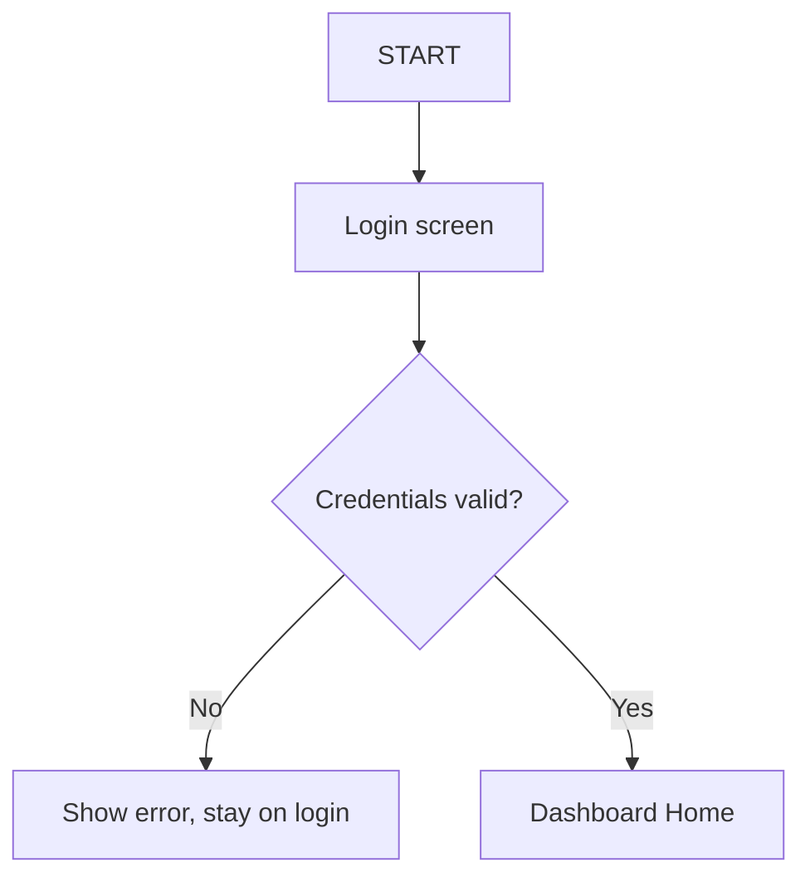
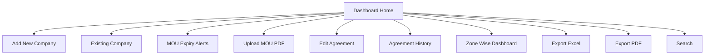

# SPEC-02 — Authentication and Dashboard Home

**Depends on:** SPEC-01 (user table, role enum).
**Source:** `docs/project_information.md` §3, §6 (feature inventory), §11 (auth endpoints)

---

## 1. Scope

- Login with valid credentials, logout, session handling.
- The Dashboard Home screen: the two primary paths plus the entry points to
  every Extra Feature.
- Role-based visibility of those entry points.

**Out of scope:** what each destination screen does — every one of them has its
own spec. This spec only guarantees the user can get there.

---

## 2. Login

| Step | Action |
|---|---|
| 1 | User enters username (or email) and password. |
| 2 | On success, a session is established and the Dashboard Home opens. |
| 3 | On failure, a single generic message is shown: "Invalid username or password." |

### 2.1 Rules

- Passwords are stored only as a salted hash. Never log, echo or return a password.
- The failure message must not reveal whether the username exists.
- An inactive user (`is_active = false`) fails login with the same generic message.
- Rate limit: after 5 consecutive failures for one username, reject further
  attempts for 15 minutes. Counter resets on success.
- Session expires after 30 minutes of inactivity; the user is returned to login.
- Every screen except login requires an authenticated session. An unauthenticated
  request returns 401 and the UI redirects to login.

### 2.2 API

| Method | Endpoint | Purpose |
|---|---|---|
| POST | `/api/auth/login` | `{username, password}` → session; returns `{userId, username, role}` |
| POST | `/api/auth/logout` | Ends the session |
| GET | `/api/auth/me` | Current user and role; 401 if no valid session |

---

## 3. Dashboard Home

The landing screen after login. It presents two primary paths and eight
supporting tools.

### 3.1 Entry points

| Entry point | Goes to | Spec |
|---|---|---|
| Add New Company | Wizard Page 1 | SPEC-03 → SPEC-04 |
| Existing Company | View Page 1 | SPEC-07 |
| MOU Expiry Alerts | Alert list | SPEC-08 |
| Upload MOU PDF | Zone → Company → Plant → Upload | SPEC-09 |
| Edit Agreement | Reason-gated edit | SPEC-10 |
| Agreement History | Version list | SPEC-11 |
| Zone Wise Dashboard | Zone summary | SPEC-12 |
| Export Excel | Excel download | SPEC-13 |
| Export PDF | Scope-gated PDF download | SPEC-13 |
| Search | Company / Plant / Scheme search | SPEC-13 |
| User Manual | Static manual page | SPEC-16 §5.5 |

> **Amended by SPEC-16 (D112).** The list above had ten entry points. The User
> Manual is the eleventh. It is static web content with no backend and no
> table, so it has no destination spec of its own — SPEC-16 §5.5 defines it.

Until a destination spec is implemented, its entry point may be disabled with a
"coming soon" state — but it must be present in the layout so the dashboard is
not rebuilt later.

### 3.2 Expiry alert indicator

The Dashboard Home shows a count badge of MOUs expiring within 90 days,
sourced from SPEC-08. Clicking it opens the alert list. When SPEC-08 is not yet
implemented, the badge is hidden.

### 3.3 Role visibility

| Entry point | ADMIN | DATA_ENTRY | VIEWER |
|---|---|---|---|
| Add New Company | yes | yes | no |
| Existing Company | yes | yes | yes |
| Expiry Alerts, Zone Dashboard, Search, Exports, History | yes | yes | yes |
| Upload MOU PDF | yes | yes | no |
| Edit Agreement | yes | no | no |
| User Manual | yes | yes | yes |

*(User Manual added by SPEC-16 D112 — it is documentation prose, so it is
visible to every role including VIEWER.)*

Hidden in the UI **and** enforced on the server. UI hiding alone is not
sufficient — every endpoint checks the role independently.

> **DECISION-PENDING (Q7)** — role set and this matrix are defaults, not stated
> in the source. Confirm with the business owner.

---

## 4. Acceptance criteria

1. Valid credentials land on Dashboard Home; invalid credentials show the generic error and stay on login.
2. An inactive user cannot log in.
3. A 6th failed attempt within the lockout window is rejected even with the correct password.
4. Visiting any dashboard URL without a session redirects to login.
5. `/api/auth/me` returns the logged-in user's role.
6. Dashboard Home renders all eleven entry points from §3.1 *(amended by SPEC-16 D112 — was ten)*.
7. A VIEWER sees no "Add New Company", "Upload MOU PDF" or "Edit Agreement"
   entry point, and a direct POST to those endpoints as a VIEWER returns 403.
8. Logging out invalidates the session; the back button does not restore an authenticated screen.
