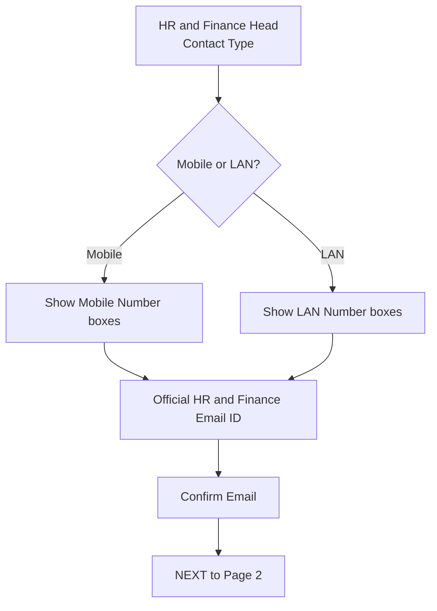

# SPEC-04 — Wizard Page 1: Company Details

**Depends on:** SPEC-01 (enums, zone master), SPEC-03 (wizard shell, draft).
**Source:** `docs/project_information.md` §4.1, §8.1–8.3, §10.1

> **Amended 2026-10-21 by SPEC-25 (D155 / D156: HR Email ID and Finance Email ID, each with a Confirm box, replace the one official email; Contact Type is no longer asked and each number may be a mobile or a LAN number).**

---

## 1. Scope

Page 1 of the Add New Company wizard: company identity, address, and the HR /
Finance contact block, including the Mobile-or-LAN conditional branch.

---

## 2. Fields (in diagram order)

> **Reordered and extended by SPEC-16 (D107, D110, D111).** The order below is
> superseded by the v2 order: **Scheme → Zone → Sector → Company Name →
> Company Type → Plant/Location → Registration Type → GST → TAN**, followed by
> the address and contact block. Two fields join it:
>
> - **Sector** (dropdown, **required**, SPEC-01 §2.10) — see SPEC-16 §5.1.
> - **Scheme** (dropdown, required) — moved to the top, and selecting one
>   reveals its guidelines panel (SPEC-16 §2.3, D113).
> - **Purchase Name / Purchase Number / Purchase Email** — a **optional**
>   block (D110). Leaving all four inputs empty still allows Next; a filled
>   Purchase Email that disagrees with Confirm Purchase Email blocks it.
>
> Everything else keeps the type and required-ness stated in the table below.

| # | Field | Type | Required | Notes |
|---|---|---|---|---|
| 1 | Company Type | dropdown | yes | SPEC-01 §2.1 |
| 2 | Company Name | text | yes | |
| 3 | Registration Type | dropdown | yes | SPEC-01 §2.2 |
| 4 | TAN Number | text | yes | uppercased on entry |
| 5 | GST Number | text | yes | uppercased on entry |
| 6 | Zone | dropdown | yes | from `/api/zones` |
| 7 | Company Plant | text | yes | becomes the first `company_plant` row |
| 8 | Address Line 1 | text | yes | |
| 9 | Address Line 2 | text | no | |
| 10 | City | text | yes | |
| 11 | PIN Code | text | yes | 6 digits |
| 12 | State | text | yes | |
| 13 | District | text | yes | |
| 14 | HR Contact Name | text | yes | |
| 15 | Finance Head Contact Name | text | yes | |
| 16 | HR and Finance Head Contact Type | radio | yes | Mobile No / LAN No — **one choice governs both contacts** |
| 17 | HR Contact Number | text | yes | Mobile or LAN box per #16 |
| 18 | Finance Head Contact Number | text | yes | Mobile or LAN box per #16 |
| 19 | Official HR and Finance Email ID | email | yes | one shared email |
| 20 | Confirm Email | email | yes | must match #19 |

---

## 3. Contact Type conditional branch

Rules:
- The single Contact Type choice applies to **both** the HR and the Finance Head
  contact. There is no per-contact override.
- Selecting Mobile shows Mobile Number inputs; selecting LAN shows LAN Number
  inputs. Only one variant is visible at a time.
- Switching the choice after typing clears both number fields and re-validates,
  so a LAN number can never be persisted as a mobile number. Warn before clearing
  if either box has content.

---

## 4. Validation

| Field | Rule |
|---|---|
| Company Name | required, trimmed, 2–150 chars |
| Company Type, Registration Type, Zone | required, must be a known enum / zone id |
| TAN Number | exactly 10 chars, `^[A-Z]{4}[0-9]{5}[A-Z]$` |
| GST Number | exactly 15 chars, `^[0-9]{2}[A-Z]{5}[0-9]{4}[A-Z][0-9][A-Z][0-9A-Z]$`; must be unique across companies |
| GST vs State | the leading 2-digit state code should reconcile with the State field — mismatch is a **warning**, not a blocker |
| Company Plant | required, 2–100 chars |
| Address Line 1, City, State, District | required |
| PIN Code | exactly 6 digits |
| HR / Finance contact numbers, when type = MOBILE | exactly 10 digits, first digit 6–9 |
| HR / Finance contact numbers, when type = LAN | 6–15 digits, optional leading STD code separated by `-` or a space |
| Official Email | valid email format |
| Confirm Email | must equal Official Email, compared case-insensitively after trimming |
| Duplicate company | reject if a company with the same `company_name` + plant already exists in the same zone |
| Sector | **required**, must be a known §2.10 enum value — added by SPEC-16 (D107) |
| Purchase Email | optional; when present must be a valid email and must equal Confirm Purchase Email, compared case-insensitively after trimming — added by SPEC-16 (D110) |

Every rule is enforced on the server as well as in the UI. GST uniqueness and
the duplicate-company check require a server round trip and run on Next.

> **DECISION-PENDING (Q11)** — what makes a company unique is not stated.
> Default: GST Number is globally unique, and Company Name + Plant is unique
> within a Zone.

### 4.1 Paste and confirm
Blocking paste into Confirm Email is deliberate — the field exists to catch a
typing mistake, and pasting the same typo defeats it.

---

## 5. Data written

None. Page 1 values are held in `company_draft.payload` (SPEC-03 §3.3). They map
to `company` columns and the first `company_plant` row at final save.

---

## 6. Acceptance criteria

1. Every dropdown is populated from `/api/enums` and `/api/zones` — no hardcoded option list in the frontend.
2. TAN `ABCD12345E` is accepted; `ABCD1234E` and `abcd12345e` before uppercasing are rejected.
3. GST with a valid 15-char pattern is accepted; a duplicate GST is rejected on Next with a field-level error.
4. Selecting Mobile shows exactly two mobile inputs and no LAN input, and vice versa.
5. Switching Contact Type after entering numbers warns, then clears both numbers.
6. `A@B.com` in Official Email and `a@b.com` in Confirm Email is accepted as matching.
7. A 5-digit or 7-digit PIN code is rejected.
8. A GST state code that disagrees with State shows a warning but still allows Next.
9. Next with any required field empty keeps the user on Page 1 and marks every offending field.
10. A second company with the same name and plant in the same zone is rejected; the same name in a different zone is accepted.
