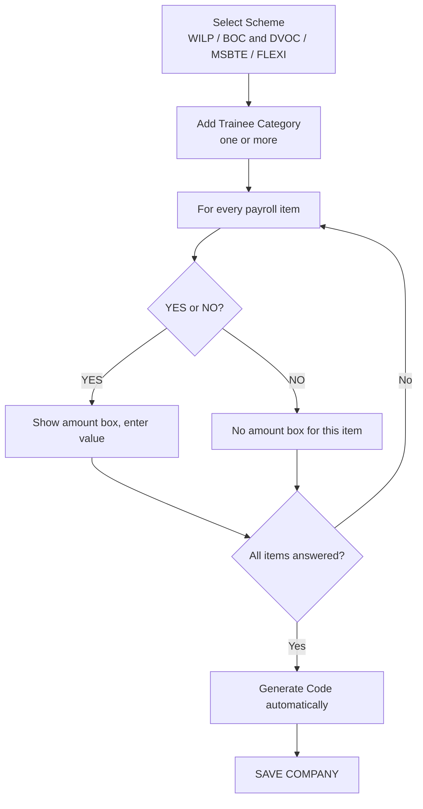

# SPEC-06 — Wizard Page 3: Payroll Details, Code Generation and Save

**Depends on:** SPEC-01 (allowance catalogue, code rule), SPEC-03, SPEC-04, SPEC-05.
**Completes:** the Add New Company flow.
**Source:** `docs/project_information.md` §4.3, §8.11, §10.3

---

## 1. Scope

Page 3 of the wizard: scheme selection, trainee categories, the Yes/No + amount
answer for all 23 payroll items, then automatic code generation and the final
save.

---

## 2. Flow

> **DECISION-PENDING (Q1)** — the source flow diagram labels the NO branch
> "Skip directly to Generate Code step", which reads as though one No aborts the
> remaining items. The narrative documentation says otherwise. Default, shown
> above: **No skips only that item's amount box**; every remaining item is still
> asked. Confirm with the business owner.

---

## 3. Fields

### 3.1 Scheme
Single-select dropdown, required: WILP, BOC and DVOC, MSBTE, FLEXI (SPEC-01 §2.4).

The wizard captures one scheme per run. A company that runs several schemes has
one MOU per scheme; the additional ones are created by running the wizard again
for the same company, or through SPEC-10. This is why `mou` is one-to-many from
`company`.

### 3.2 Trainee Category
Repeatable free-text rows under the selected scheme. At least one is required.
Category names are unique within the config, compared case-insensitively.

### 3.3 Payroll items

> **Rebuilt by SPEC-16 (D105, D106, D108).** Both the catalogue and the control
> changed. The catalogue is no longer SPEC-01 §4 — it is SPEC-16 §2.6: **8 fixed
> allowances followed by 15 fixed deductions, plus one shared `OTHER` key**
> (24 entries). The Yes/No control became a **checkbox**: checked means
> applicable, unchecked still writes the row with `is_applicable = false`.
> A checkbox has no unanswered state, so the "every item must have an explicit
> Yes or No" rule and its "N of 22 answered" counter were **removed**.
> The `INSURANCE` item additionally carries the insurance sub-model
> (`insurance_type` + GFS/MOU amounts) of SPEC-01 §2.13. See SPEC-16 §5.3.

All 23 items from SPEC-01 §4, in that exact order *(superseded — see above)*:

Attendance Bonus, 1st Year Allowance, 2nd Year Allowance, 3rd Year Allowance,
Accommodation Allowance, Arrears, Bonus, Canteen Allowance, Conveyance,
Document Fee, Education Allowance, Ex-Gratia, Foundry Allowance, Leave
Encashment, Leave With Wages, Night Shift Allowance, Reimbursement of Education
Charges, Special Allowance, Registration Fee, Travelling Allowance, Uniform
Refund, Washing Allowance, Other.

Each of items 1–22 renders as a Yes/No control *(superseded by a checkbox)*:
- **Yes** reveals an amount box; the amount is then required.
- **No** hides the amount box and the item persists with `is_applicable = false`, `amount = NULL`.
- Switching Yes → No clears the amount.

Item 23, **Other**, is a repeatable block like SPEC-05 §2.3: label + amount +
Allowance/Deduction, zero or more rows.

Each item's `item_type` comes from the SPEC-01 §4 mapping; the user does not
choose it, except on "Other" rows.

---

## 4. Validation

| Rule |
|---|
| Scheme required |
| At least one trainee category; each 1–100 chars, unique within the config |
| ~~Every one of items 1–22 must have an explicit Yes or No — no item may be left unanswered~~ **removed by SPEC-16 D106** |
| Checked → amount required, numeric, non-negative, ≤ 2 decimal places, ≤ 9,999,999.99 *(was "Yes")* |
| Unchecked → amount box hidden and stored as NULL *(was "No")* |
| Insurance with type "Both" → **both** the GFS and MOU amounts are required; with "Top Up (GFS)" only the GFS amount; with "Recovery (MOU)" only the MOU amount *(added by SPEC-16 D108)* |
| "Other" row → if any field is filled, label, amount and type all become required; labels unique within the page |
| The same company + plant + scheme must not already have a current MOU |

~~A progress indicator shows how many of the 22 items remain unanswered. **Save**
stays disabled until the count reaches zero.**~~ **Removed by SPEC-16 D106** —
a checkbox has no unanswered state, so there is no count to reach zero and
**Save** is not gated on one. Saving with **nothing** checked is valid and
writes 23 rows, all `is_applicable = false`.

---

## 5. Code generation and save

1. When validation passes, the user presses **Save**.
2. The server generates the **MOU** code per **SPEC-01 §6.3** —
   `MOU-<SCHEME>-<YYYY>-<NNNN>` *(was the company code, `<ZONE_CODE>-<YY>-<NNNN>`;
   moved to `mou` by SPEC-16 D109)*.
3. The full save transaction from **SPEC-03 §4** runs.
4. On success a confirmation screen shows the generated code, the company name
   and the scheme, with links to view the company (SPEC-07) or return to the
   dashboard.

The code is server-generated, unique and permanently non-editable. It is never
shown before save, because nothing is reserved before save.

---

## 6. Data written

At final save:
- `payroll_config` — one row for the MOU
- `trainee_category` — one row per category
- `payroll_item` — 22 rows for the fixed items plus one per "Other" row
- `mou.scheme` — the selected scheme
- `company.generated_code` — the generated code

Plus everything from SPEC-04 and SPEC-05, in the same transaction.

---

## 7. Acceptance criteria

> **Amended by SPEC-16.** AC2, AC4, AC7, AC8 and AC9 below are rewritten; the
> rest are unchanged. Amended text is marked inline.

1. Answering No to Attendance Bonus still presents 3rd Year Allowance and every other remaining item.
2. ~~Save is disabled while any of the 22 items is unanswered, and the remaining count is visible.~~ **Rewritten (D106):** saving with **nothing** checked succeeds and writes 23 `payroll_item` rows, all `is_applicable = false`. There is no unanswered state and no counter.
3. Answering Yes with an empty amount blocks Save with a field-level error.
4. ~~Switching an item from Yes with 500 to No…~~ **Rewritten (D106):** *unchecking* an item that held 500 stores `is_applicable = false` and `amount = NULL`.
5. Saving with zero trainee categories is rejected.
6. Two categories named "Trainee" and "trainee" are rejected as duplicates.
7. ~~exactly 22 rows…~~ **Rewritten (D105):** after save exactly **23** fixed-key `payroll_item` rows exist — the SPEC-16 §2.6 catalogue — plus one per "Other" row.
8. ~~`<ZONE_CODE>-<YY>-<NNNN>`…same zone and year…~~ **Rewritten (D109):** the code is `MOU-<SCHEME>-<YYYY>-<NNNN>`, it belongs to the **MOU**, and two saves for the same **scheme** and year produce consecutive sequence numbers. A company onboarded twice with two different schemes holds two MOUs with two different codes.
9. ~~item_type from SPEC-01 §4, DOCUMENT_FEE and REGISTRATION_FEE as DEDUCTION…~~ **Rewritten (D105):** every saved `payroll_item` carries the `item_type` from **SPEC-16 §2.6** — the 8 allowances as ALLOWANCE and the 15 deductions (including `DOCUMENT_FEE` and `COURSE_REGISTRATION_FEE`) as DEDUCTION.
10. A second wizard run for the same company + plant + scheme is rejected while a current MOU exists.
11. A save that fails validation server-side writes nothing and leaves the draft intact.
12. **Added (D108):** checking Insurance with type "Both" requires both the GFS and the MOU amount; with "Top Up (GFS)" only the GFS amount; with "Recovery (MOU)" only the MOU amount.
13. **Added (D109):** the generated code appears on the success screen in `MOU-<SCHEME>-<YYYY>-<NNNN>` form and matches the MOU's scheme.
