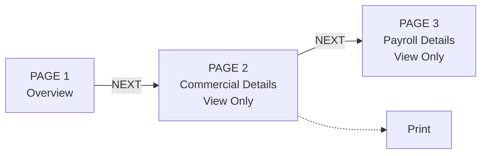
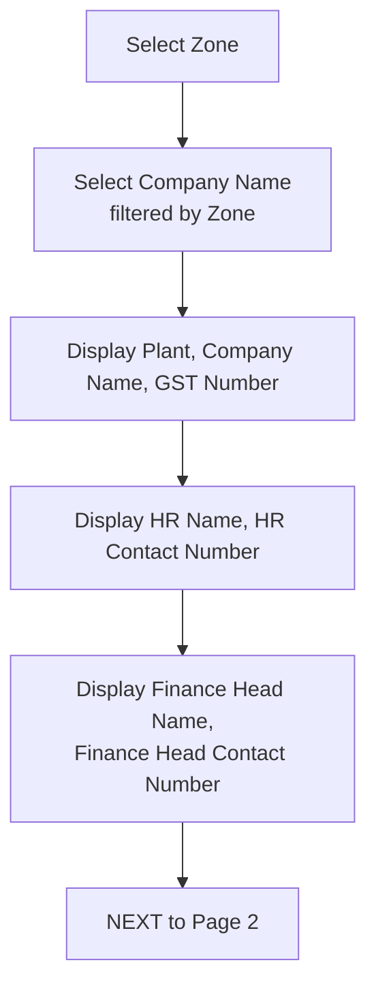
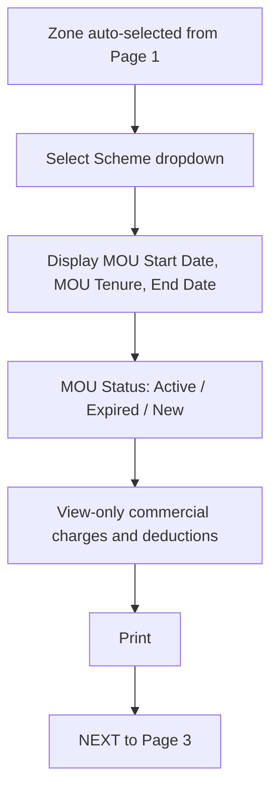
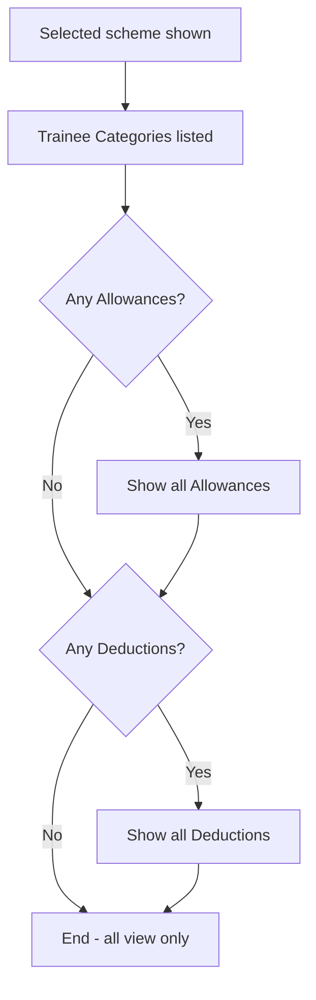

# SPEC-07 — Existing Company: 3-Page View Flow

**Depends on:** SPEC-01, SPEC-02, and data created by SPEC-04–06.
**Source:** `docs/project_information.md` §5, §10.5

---

## 1. Scope

The read-only review flow: look up a company by zone, then walk its overview,
commercial terms and payroll configuration. Includes the Print action on Page 2.

**Every field in this flow is view-only.** No screen here writes anything.

---

## 2. Flow

Back navigation is available on Pages 2 and 3.

---

## 3. Page 1 — Overview

| Step | Action |
|---|---|
| 1 | Select a **Zone** from the zone master. |
| 2 | Optionally select a **Scheme** to filter the company list — added by SPEC-16 (D101/D112); a **Clear** control resets it. |
| 3 | Select a **Company Name**. The list is filtered to that zone (and to the scheme when one is chosen) and is empty until a zone is chosen. |
| 4 | The system displays the company's details below. |

**Displayed fields:** Plant, Company Name, GST Number, Sector, HR Name, HR
Contact Number, Finance Head Name, Finance Head Contact Number.

Also shown for orientation: the generated code — **the MOU's**
`MOU-<SCHEME>-<YYYY>-<NNNN>`, not a company-level code, since SPEC-16 D109
moved the code onto the agreement. A company holding several MOUs has one code
per MOU; the one shown is that of the MOU in context.

If the company has more than one plant, a plant selector appears and the
displayed plant follows it; the selection carries to Pages 2 and 3.

**Next** is disabled until a company is selected.

---

## 4. Page 2 — Commercial Details (view only)

| Step | Action |
|---|---|
| 1 | **Zone** carries over automatically from Page 1 and is not re-selected. |
| 2 | Select a **Scheme**. A company can run more than one scheme, so this choice decides which MOU is displayed. |
| 3 | The system shows that MOU's **Start Date** and **Tenure** (and the derived End Date). |
| 4 | **MOU Status** is shown as Active, Expired or New. |
| 5 | All commercial fields captured on wizard Page 2 are displayed, strictly view-only. |
| 6 | A **Print** option downloads everything shown up to this point. |

### 4.1 Scheme dropdown
Lists only the schemes for which this company + plant actually has an MOU — not
the full SPEC-01 §2.4 enum. If exactly one exists it is preselected. If none
exists, the page shows an empty state and Next is disabled.

### 4.2 MOU Status
Derived per SPEC-01 §6.2 at render time, never read from a stored column.
Rendered with a distinct visual treatment per value — Active, Expired, New —
that does not rely on colour alone.

### 4.3 Displayed fields
Attendance Cycle, Stipend Date, and all 16 charge items in SPEC-01 §3 order,
followed by every `commercial_other_item` row with its label, amount and type.

A charge stored as `NULL` displays as "—" and one stored as `0.00` displays as
`0.00`. The distinction is visible.

The attached MOU PDF is listed with its filename and upload date, and can be
downloaded.

### 4.4 Print
Produces a printable document covering **Page 1 and Page 2** — company identity,
contacts, MOU dates, status, and every commercial charge. Payroll data is not
included; SPEC-13's Export PDF covers the full record.

> **DECISION-PENDING (Q10)** — "all fields so far" is read as Page 1 + Page 2.
> Confirm whether payroll should also be printable from here.

---

## 5. Page 3 — Payroll Details (view only)

| Step | Action |
|---|---|
| 1 | The scheme selected on Page 2 is shown, read-only. |
| 2 | Trainee categories under that scheme are listed. |
| 3 | Configured **Allowances** are displayed, if any. |
| 4 | Configured **Deductions** are displayed, if any. |

### 5.1 Allowance / Deduction split
Items are grouped by `payroll_item.item_type` using the SPEC-01 §4 mapping.
Only items with `is_applicable = true` are shown — an item answered No is
omitted entirely rather than shown with a blank amount.

A group with no qualifying items is omitted, along with its heading. If both
groups are empty, the page shows "No payroll items configured for this scheme."

---

## 6. API

| Method | Endpoint | Purpose |
|---|---|---|
| GET | `/api/zones` | Zone dropdown (SPEC-01) |
| GET | `/api/zones/{zoneId}/companies` | Company dropdown for Page 1 |
| GET | `/api/zones/{zoneId}/companies?scheme=` | The same list filtered by scheme — added by SPEC-16 |
| GET | `/api/companies/{id}/overview` | Page 1 display fields |
| GET | `/api/companies/{id}/mous?plantId=` | Schemes that have an MOU, for the Page 2 dropdown |
| GET | `/api/mous/{mouId}/commercial` | Page 2 data including derived status and end date |
| GET | `/api/mous/{mouId}/payroll` | Page 3 data, grouped into allowances and deductions |
| GET | `/api/mous/{mouId}/print` | Printable Page 1 + Page 2 document |

All endpoints are read-only and available to every role including VIEWER.

---

## 7. Acceptance criteria

1. The company dropdown is empty until a zone is selected, and lists only companies in that zone.
1a. Selecting a scheme filters the company list to companies holding an MOU for that scheme, and Clear resets the filter. *(added by SPEC-16)*
1b. The code shown on the overview is the MOU's `MOU-<SCHEME>-<YYYY>-<NNNN>`, not a company-level code. *(amended by SPEC-16 D109)*
2. Selecting a company displays plant, GST, and both contact names and numbers.
3. Zone is not re-selectable on Page 2; it is inherited from Page 1.
4. A company with MOUs for WILP and FLEXI shows exactly those two options in the scheme dropdown, not all four.
5. Switching the scheme reloads the commercial and payroll data for that MOU.
6. An MOU whose start date is in the future shows status New; one past its end date shows Expired.
7. No input on any of the three pages is editable, and no endpoint in §6 accepts a write.
8. A charge saved as NULL renders as "—" and one saved as 0 renders as 0.00.
9. Print produces a document containing Page 1 and Page 2 fields and nothing from Page 3.
10. An item answered No during the wizard does not appear on Page 3.
11. A scheme with only deduction-type items shows the Deductions group and no empty Allowances heading.
