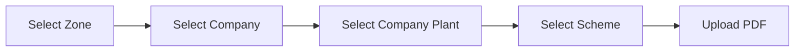

# SPEC-09 — Upload MOU PDF (standalone)

**Depends on:** SPEC-01, SPEC-02. Reuses the PDF validation from SPEC-05 §3.
**Source:** `docs/project_information.md` §6.2

---

## 1. Scope

A standalone, guided path for attaching an MOU PDF to an existing MOU — used
when the signed document arrives after the company record was created, or when a
replacement copy is issued.

This is separate from the wizard upload (SPEC-05), which happens during data
entry. Both write to the same `mou_document` table and share one validation and
storage routine — the file-validation logic is implemented once and called from
both places.

---

## 2. Flow

| Step | Action |
|---|---|
| 1 | Select **Zone**. |
| 2 | Select **Company** — filtered by the chosen zone. |
| 3 | Select **Company Plant** — filtered by the chosen company. |
| 4 | Select **Scheme** — the MOU the document belongs to. |
| 5 | **Upload** the PDF. |

Each selector is disabled until the one before it has a value, and changing an
earlier selection clears every later one.

### 2.1 The scheme step
The source flow shows four steps and goes straight from plant to upload. A
document attaches to an `mou` row, and one company + plant can hold several MOUs
— one per scheme. Without a scheme the target is ambiguous, so the scheme step
is added. When the selected company + plant has exactly one MOU, the step is
auto-resolved and hidden, which makes the common case the four steps the source
describes.

---

## 3. Upload rules

- PDF only: `application/pdf` MIME type **and** a `%PDF` file-header check.
- Maximum 10 MB.
- Filename sanitised before storage; the original name is kept in
  `mou_document.original_filename` for display.
- Virus-scanned if a scanner is available.
- Stored outside the web root, served only through an authenticated endpoint.
  A stored file must never be reachable by guessing a URL.

### 3.1 Multiple documents
Uploading does not delete what is already attached. Each upload adds a
`mou_document` row, and the most recent one is treated as the current document
wherever a single document is shown (SPEC-07 §4.3). The full list is visible on
the upload screen with filename, size, uploader and upload date, and earlier
documents can be downloaded.

Deleting a document is not part of this spec.

---

## 4. API

| Method | Endpoint | Purpose |
|---|---|---|
| GET | `/api/companies/{id}/plants` | Plant dropdown (SPEC-01) |
| GET | `/api/companies/{id}/mous?plantId=` | Scheme dropdown |
| GET | `/api/mous/{mouId}/documents` | Documents already attached |
| POST | `/api/mous/{mouId}/document` | Multipart upload → new `mou_document` row |
| GET | `/api/documents/{documentId}` | Authenticated download |

Upload requires ADMIN or DATA_ENTRY. Download is open to all authenticated roles.

---

## 5. Acceptance criteria

1. The company dropdown stays empty and disabled until a zone is chosen; likewise plant after company.
2. Changing the zone after selecting a company clears the company, plant and scheme selections.
3. A company + plant with exactly one MOU skips the scheme step.
4. A company + plant with two schemes requires an explicit scheme choice before upload is enabled.
5. A `.docx` renamed to `.pdf` is rejected.
6. An 11 MB file is rejected.
7. A successful upload adds a row and leaves any previously attached document in place.
8. After a second upload, SPEC-07's commercial page shows the newer document as current.
9. Requesting a document URL without a session returns 401.
10. A VIEWER attempting an upload receives 403 but can still download.
