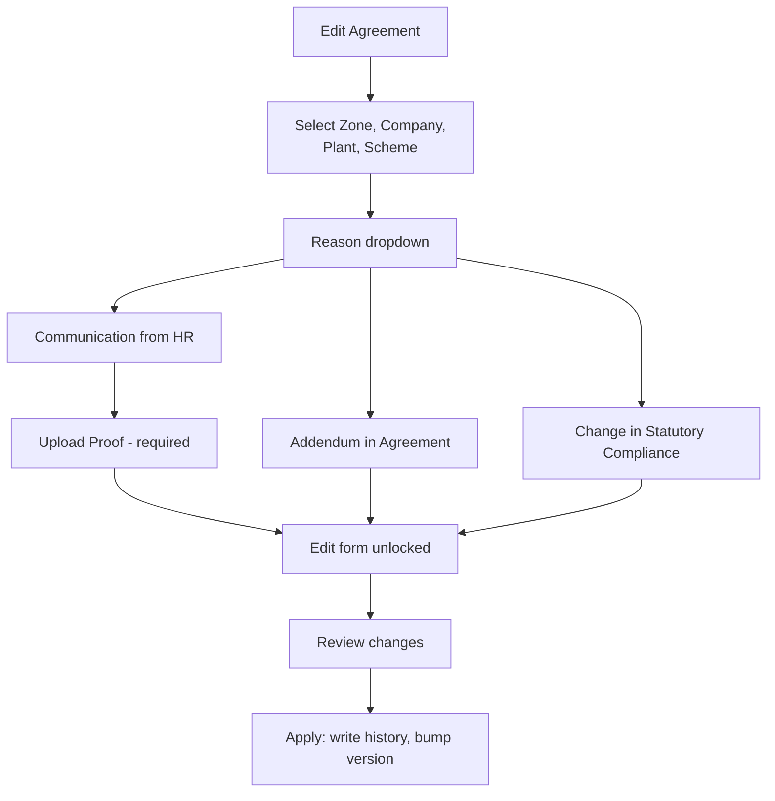

# SPEC-10 — Edit Agreement

**Depends on:** SPEC-01, SPEC-05, SPEC-06 (the field definitions being edited), SPEC-07 (navigation).
**Pairs with:** SPEC-11 — every edit writes a history row.
**Source:** `docs/project_information.md` §6.3, §8.7

---

## 1. Scope

Amending an already-saved MOU. An edit is never silent: the user must first
state a reason, and for one reason must upload supporting proof. Every applied
edit snapshots the prior state into `agreement_history`.

---

## 2. Flow

---

## 3. Reason gate

| Reason | Behaviour |
|---|---|
| **Communication from HR** | The user must upload supporting proof before the edit form unlocks. |
| **Addendum in Agreement** | Proceeds directly to the edit. |
| **Change in Statutory Compliance** | Proceeds directly to the edit. |

Rules:
- The reason is chosen **before** any field becomes editable. There is no path to
  an unlocked form without a reason on record.
- The proof requirement is enforced on the server. A request carrying
  `COMMUNICATION_FROM_HR` without a proof file is rejected, whatever the UI did.
- Proof file: PDF or image (`application/pdf`, `image/png`, `image/jpeg`), max
  10 MB, header-checked like SPEC-05 §3, stored outside the web root.
- An optional free-text remark (up to 500 characters) can accompany any reason
  and is stored on the history row.

---

## 4. Editable scope

Once unlocked, the user may edit:

**Commercial terms** (SPEC-05) — MOU start date, tenure value and unit,
attendance cycle, stipend date, all 16 charge amounts, and the "Other" rows.

**Payroll configuration** (SPEC-06) — trainee categories, and each item's
applicable/amount state *(was "Yes/No answer" — SPEC-16 D106 replaced the
control with a checkbox)*, including "Other" rows.

**Not editable here:**
- Company identity — name, type, registration type, TAN, GST, zone, address,
  contacts (SPEC-04 fields).
- `mou.generated_code` — permanently immutable. *(amended by SPEC-16 D109 —
  the code moved from `company` to `mou`.)*
- Scheme — an MOU's scheme defines its identity. A different scheme means a
  different MOU, created through the wizard.

> **DECISION-PENDING (Q8)** — the source does not state which fields become
> editable. Default above: commercial terms and payroll only, because those are
> what an addendum or a statutory change actually alters. Company identity
> corrections would need a separate flow.

Validation on every edited field is exactly the rule set from SPEC-05 §3 and
SPEC-06 §4 — the same code path, not a second copy. Changing the start date or
tenure recomputes `end_date` per SPEC-01 §6.1.

---

## 5. Applying the edit

Inside one transaction:

1. Re-validate the whole edited payload server-side.
2. Snapshot the MOU's current state — `mou`, `commercial_detail`,
   `commercial_other_item`, `payroll_config`, `trainee_category`, `payroll_item` —
   into `agreement_history.snapshot` as JSON, with the current `version`.
3. Write the history row: reason, proof path, remark, `edited_by`, `edited_at`.
4. Apply the changes to the live rows.
5. Increment `mou.version`.

The MOU keeps one live row that always reflects the current agreement; prior
states live only in history. `is_current` stays true throughout.

Before applying, the user sees a **review screen** listing every changed field as
old value → new value. Applying with nothing changed is rejected: "No changes to
apply."

### 5.1 Concurrency
The edit form carries the `version` it loaded. If the stored version has moved on
by the time Apply is pressed, the request is rejected with "This agreement was
changed by someone else. Reload and try again." A stale edit must never
overwrite a newer one.

---

## 6. Permissions

ADMIN only. DATA_ENTRY and VIEWER receive 403 on every endpoint here, and the
Dashboard Home entry point is hidden for them (SPEC-02 §3.3).

---

## 7. API

| Method | Endpoint | Purpose |
|---|---|---|
| POST | `/api/mous/{mouId}/edit-request` | Multipart: reason, optional remark, optional proof file → returns an edit token and the current editable payload with its version |
| PUT | `/api/mous/{mouId}` | Body: edit token + edited payload + loaded version → applies the edit and writes history |

The edit token binds the applied edit to the reason that authorised it. A `PUT`
without a valid, unconsumed token is rejected — this is what prevents an edit
with no recorded reason.

---

## 8. Acceptance criteria

1. No field is editable before a reason is selected.
2. Selecting "Communication from HR" keeps the form locked until a proof file is uploaded.
3. A direct `PUT` with reason COMMUNICATION_FROM_HR and no proof is rejected with 400.
4. A `PUT` without an edit token is rejected, even from an ADMIN.
5. "Addendum in Agreement" and "Change in Statutory Compliance" unlock the form with no upload.
6. Company name, GST and generated code are not present in the editable payload, and sending them is ignored rather than applied.
7. Applying an edit increments `mou.version` by exactly 1 and writes exactly one `agreement_history` row.
8. The history snapshot contains the values as they were **before** the edit.
9. Editing tenure from 24 to 36 months recomputes and stores the new end date.
10. An edit that empties every trainee category is rejected by the SPEC-06 rule.
11. Two users loading the same MOU and both applying: the second receives the stale-version error and their change is not written.
12. Applying with no changed field is rejected.
13. A DATA_ENTRY user calling either endpoint receives 403.
