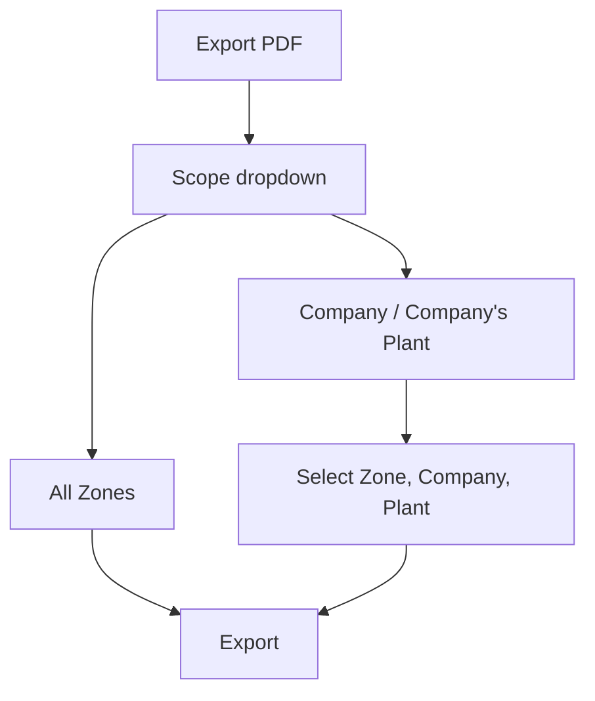

# SPEC-13 — Search, Export Excel and Export PDF

**Depends on:** SPEC-01, SPEC-02, and data created by SPEC-04–06.
**Source:** `docs/project_information.md` §6.6, §6.7, §6.8, §8.8, §8.9

Three read-only tools grouped together because they share one filter and one
query layer: what Search selects is what Export writes out.

---

## 1. Scope

- **Search** — locate a record by Company, Plant or Scheme.
- **Export Excel** — download company / MOU data as a workbook.
- **Export PDF** — download a document scoped to All Zones or one company.

Nothing here writes to the record tables.

---

## 2. Search

### 2.1 Behaviour
A **Search By** selector plus a query box.

| Search By | Matches against |
|---|---|
| Company | `company.company_name` and `company.generated_code` |
| Plant | `company_plant.plant_name` |
| Scheme | `mou.scheme` — a picker, not free text |

Rules:
- Case-insensitive partial match for Company and Plant; minimum 2 characters.
- Scheme is an exact match chosen from a dropdown, because it is an enum.
- Results are paginated, 25 per page, ordered by company name.
- No match shows "No records found for '<query>'."

### 2.2 Result columns
Company Name, Generated Code, Zone, Plant, Scheme, MOU Start Date, End Date,
MOU Status. Each row links to the Existing Company view (SPEC-07).

A company with several MOUs produces one row per current MOU, so the scheme and
its dates are unambiguous.

### 2.3 Extra filters
Zone and MOU status narrow the result set further, and carry into an export
started from the results.

---

## 3. Export Excel

Downloads the company / MOU data as an `.xlsx` workbook.

### 3.1 Scope
Exports the current search result set including its filters. With no search
active, it exports everything the user may see.

### 3.2 Workbook layout
| Sheet | Contents |
|---|---|
| Companies | one row per company: code, name, type, registration type, TAN, GST, zone, plant(s), address block, HR and Finance contact names, numbers, email |
| MOUs | one row per current MOU: company code, plant, scheme, start date, tenure value, tenure unit, end date, derived status, attendance cycle, stipend date |
| Commercial | one row per MOU, one column per charge item in SPEC-01 §3 order, followed by "Other" items as label/amount/type triples |
| Payroll | one row per `payroll_item` where `is_applicable = true`: company code, scheme, trainee categories, item label, item type, amount |

Rules:
- Amounts are written as numbers, not text, so the sheet is usable for arithmetic.
- Dates are written as date values in `dd-MM-yyyy` display format.
- A `NULL` charge is left blank; a stored `0.00` is written as `0`.
- Header rows are frozen and columns auto-sized.

---

## 4. Export PDF

### 4.1 Scope selection

| Scope | Behaviour |
|---|---|
| **All Zones** | A summary document across every zone |
| **Company / Company's Plant** | A detailed document for one selected company and plant |

Choosing the company scope reveals cascading Zone → Company → Plant selectors,
as in SPEC-09 §2. Export is disabled until the scope is fully resolved.

### 4.2 All Zones document
The SPEC-12 zone summary — counts per zone, the scheme matrix — followed by a
company listing grouped by zone with code, name, plant, scheme, dates and status.

### 4.3 Company document
The full record for one company and plant: company details, contacts, and then
per scheme the MOU dates and status, all commercial charges, trainee categories,
allowances and deductions. This is the complete record, unlike the SPEC-07 §4.4
Print, which stops at commercial details.

### 4.4 Common
Every page carries the generation timestamp, the generating user, and page
numbers. Money is right-aligned with two decimals. A blank charge prints "—".

---

## 5. Shared rules

- Both exports are generated server-side from the same query layer that Search
  uses. A filter that changes the search result changes the export identically —
  this is why the three live in one spec.
- Exports respect role visibility. A user only ever exports rows they could see
  on screen.
- An export of more than 5,000 companies is generated asynchronously: the request
  returns a job id, and the file is offered for download when ready.
- Generated files are downloaded through the authenticated endpoint (SPEC-09 §3),
  never a guessable URL, and are deleted after 24 hours.

---

## 6. API

| Method | Endpoint | Purpose |
|---|---|---|
| GET | `/api/search?by=company\|plant\|scheme&q=&zoneId=&status=&page=` | Search results |
| GET | `/api/export/excel?by=&q=&zoneId=&status=` | Excel export of the filtered set |
| GET | `/api/export/pdf?scope=all_zones\|company&companyId=&plantId=` | PDF export |
| GET | `/api/export/jobs/{jobId}` | Async export status and download link |

Read-only, available to every authenticated role.

---

## 7. Acceptance criteria

1. Searching by Company for "tat" returns companies whose name contains "tat", case-insensitively.
2. Searching by the generated code returns the matching company.
3. A single-character query is rejected with a minimum-length message.
4. Search by Scheme offers a dropdown, not a text box, and returns exact matches only.
5. A company with WILP and FLEXI MOUs produces two result rows.
6. Zone and status filters narrow the results and carry into an export started from them.
7. The Excel export contains all four sheets, and amounts are numeric cells rather than text.
8. A charge stored as NULL is a blank Excel cell; one stored as 0 is the number 0.
9. Export PDF with scope All Zones produces the zone summary and the grouped company listing.
10. Export PDF with the company scope stays disabled until zone, company and plant are all chosen.
11. The company-scope PDF includes payroll allowances and deductions, which the SPEC-07 Print does not.
12. Exporting with a search filter active yields exactly the filtered rows, no more.
13. A generated export file is unreachable without a session and is gone after 24 hours.
