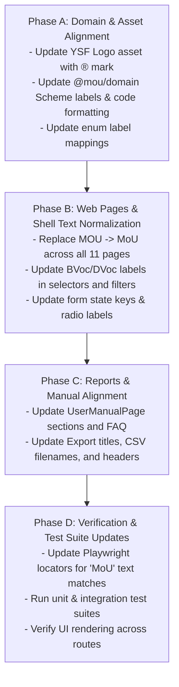

# SPEC-17 — Design Revision v3 Alignment

**Depends on:** SPEC-01 to SPEC-16.  
**Source:** `figma_code-v3/` — third Figma Make export, diffed against `figma_code-v2/` on 2026-09-27.  
**Status:** Draft specification.

---

## 0. Executive Summary & Decisions

`figma_code-v3` introduces copy, branding, and casing standardization across all screens, navigation items, export reports, and manual sections.

### Key Changes Summary

1. **MoU Casing Normalization (`MOU` $\rightarrow$ `MoU`)**:
   - Universal replacement of all-caps `MOU` with mixed-case `MoU` across UI headers, labels, table columns, export filenames, and dialogs (e.g., `MoU Code`, `MoU Start Date`, `Upload MoU PDF`, `MoU Expiry Alerts`, `Active MoUs`, `MoU Summary Report`).
2. **Scheme Label Casing (`BVOC`/`DVOC` $\rightarrow$ `BVoc`/`DVoc`)**:
   - Scheme names updated in dropdowns, badges, catalogue descriptions, and user manual tables: `BVoc` (Bachelor of Vocation) and `DVoc` (Diploma of Vocation).
3. **Identifier & Component Names**:
   - Component `UploadMOUPage` $\rightarrow$ `UploadMoUPage`.
   - Insurance sub-type and category field: `insuranceMOU` $\rightarrow$ `insuranceMoU`, `Recovery (MOU)` $\rightarrow$ `Recovery (MoU)`.
   - Code prefix in demo/sample previews: `MoU-<SCHEME>-<YYYY>-<NNNN>`.
4. **YSF Trademark Logo Asset**:
   - Brand logo updated with the registered trademark symbol ($\text{\textregistered}$) on "Yuvashakti Foundation".

### Explicitly Out of Scope
* **Multilingual AI Chatbot Prompts**: The floating AI assistant / chatbot feature (`LANG_OPTIONS` and bot dialogs) is out of scope and not implemented.

### Architectural & Design Decisions

| # | Decision | Choice | Rationale |
|---|---|---|---|
| D116 | Display vs. Database Casing | **Keep DB enum values as `BVOC` and `DVOC`**, format as `BVoc` and `DVoc` in UI presentation layer | Avoids breaking existing database records, migrations, and API contracts. `@mou/domain` enum labels map `BVOC` $\rightarrow$ `"BVoc"` and `DVOC` $\rightarrow$ `"DVoc"`. |
| D117 | Agreement Code Prefix | **Keep DB uppercase `MOU-`**, format as `MoU-` in UI display layer | Preserves DB invariants and existing data while satisfying Figma v3's `MoU-` visual presentation. |
| D118 | Insurance Property in Payload | **Update UI state to `insuranceMoU`**, accept both `insuranceMoU` and `insuranceMOU` in domain/API | Ensures backward compatibility for existing drafts and payloads while aligning form state with v3. |
| D119 | Export Filenames & Titles | **Update all export filenames, Excel titles, and PDF headers to `MoU`** | Standardizes `MoU_Export.csv`, `MoU_Expiry_Alerts.csv`, `MoU Summary Report`, and PDF headers across the app. |
| D120 | Logo Asset Replacement | **Replace `logo-ysf.png` in web assets with the registered trademark logo** from `figma_code-v3` | Brand compliance with the updated registered trademark ($\text{\textregistered}$) design. |
| D121 | UI & User Manual Copy Normalization | **Update all 11 pages, sidebar items, and User Manual (12 sections + FAQ)** to `MoU` and `BVoc`/`DVoc` | Complete visual and documentation consistency across the platform. |

---

## 1. Comprehensive Changes by Component & Screen

### 1.1 Global & App Shell
* **Sidebar (`Sidebar.tsx`, `AppShell.tsx`)**:
  * Nav items updated: `Upload MOU` $\rightarrow$ `Upload MoU`, `MOU Expiry Alert` $\rightarrow$ `MoU Expiry Alert`.
  * YSF Logo replaced with registered trademark asset.
* **Topbar (`Topbar.tsx`)**:
  * Subtitles standardized with `MoU` across all pages.
* **PDF Print Template (`printPDF` / `mou-view.ts`)**:
  * Header/Footer: `Generated by YSF MoU Management System · {date}`.
  * Document Title: `MoU Agreement — {company}`.

### 1.2 Dashboard (`DashboardPage.tsx`)
* **KPI Tiles**:
  * `Active MOUs` $\rightarrow$ `Active MoUs`.
  * `Total MOUs` $\rightarrow$ `Total MoUs`.
* **Quick Actions Grid**:
  * `Add New Company`: `Register a new MoU company`.
  * `Search Company`: `View existing MoU details`.
  * `Edit Agreement`: `Amend or update an MoU`.
  * `Upload MoU PDF`: `Attach signed documents`.
  * `Expiry Alerts`: `{count} MoUs expiring soon`.
* **Recent Activity / Table Columns**:
  * Table header: `MoU Code` (was `MOU Code`).
* **Expiring Banner**:
  * `{count} MoUs expiring within 30 days`.
  * Button: `View Expiring MoUs`.

### 1.3 Add Company Wizard (`AddCompanyPage.tsx`)
* **Step 1 — Company Details**:
  * Topbar subtitle: `Register a company for MoU / Apprenticeship scheme`.
  * Scheme Dropdown options & guidelines: `BVoc`, `DVoc`.
* **Step 2 — Commercial Details**:
  * Labels: `MoU Start Date`, `MoU Tenure (months)`, `MoU End Date`.
  * Section title: `Commercial as per MoU`.
  * Upload Box: `Upload MoU PDF *`.
* **Step 3 — Payroll & Trainee Categories**:
  * Insurance radio options: `Top Up (GFS)`, `Recovery (MoU)`, `Both`.
  * Insurance label: `Recovery Amount — MoU (₹/month)`.
  * Category state key: `insuranceMoU`.
* **Summary & Success Confirmation**:
  * Success message: `MoU Code generated: MoU-WILP-2026-0343`.
  * Summary review rows: `MoU Start`, `MoU PDF`.

### 1.4 Existing Company Profile (`ExistingCompanyPage.tsx`)
* **Header & Quick Action**:
  * Subtitle: `Search, view and manage MoU company records`.
  * Button: `{Icon} Upload MoU`.
* **Overview & Commercial Tabs**:
  * Field labels: `MoU Code`, `MoU Start`, `Expires`.
  * Agreement Table Header: `MoU Code`, `Start`, `End`, `Scheme`, `Status`.
  * Document List: `MoU_RIL_Sep2024.pdf`.
  * Scheme filters and chips: `BVoc`, `DVoc`.

### 1.5 Edit Agreement (`EditAgreementPage.tsx`)
* **Topbar**:
  * Subtitle: `Amend or update an existing MoU record`.
* **Selectors & Summary Preview**:
  * Scheme options: `['NAPS', 'NATS', 'WILP', 'BVoc', 'DVoc', 'FLEXI', 'MSBTE']`.
  * Field labels: `MoU Code`, `MoU Start Date`, `MoU End Date`.

### 1.6 Standalone Upload MoU (`UploadMouPage.tsx`)
* **Component & Page Name**: `UploadMoUPage` / `UploadMouPage`.
* **Topbar**: `Upload MoU PDF` — `Attach signed MoU documents to company records`.
* **Scheme Selector**: `['NAPS', 'NATS', 'WILP', 'BVoc', 'DVoc', 'FLEXI', 'MSBTE']`.
* **Reference Number Placeholder**: `e.g. RIL/HR/MoU/2026/001`.

### 1.7 Expiry Alerts (`AlertsPage.tsx`)
* **Topbar & Header**:
  * Title: `MoU Expiry Alerts` — `Upcoming expirations requiring action`.
  * Filter label: `All Expiring MoUs`.
* **Export & Table Columns**:
  * CSV filename: `MoU_Expiry_Alerts.csv`.
  * Table Header: `MoU Code`.

### 1.8 Agreement History (`AgreementHistoryPage.tsx`)
* **Topbar & Filters**:
  * Subtitle: `Complete record of all MoU agreements`.
  * Scheme filter options: `BVoc`, `DVoc`.
* **Table & Export**:
  * Table Header: `MoU Code`.
  * Export columns: `MoU Code`.

### 1.9 Reports & Exports (`ExportExcelPage.tsx`, `ExportPdfPage.tsx`, `SearchPage.tsx`)
* **Topbar & Subtitle**:
  * Title: `Export Data` — `Download MoU reports in various formats`.
* **Reports List**:
  * `MoU Summary Report` — `All company MoU records with status` (`Excel (.xlsx)`).
  * `MoU Documents Bulk` — `Bulk PDF download of signed MoUs` (`ZIP (.zip)`).
  * CSV Export filename: `MoU_Export.csv`.
  * Filter Scheme Dropdown: `['All Schemes', 'NAPS', 'NATS', 'WILP', 'BVoc', 'DVoc', 'FLEXI', 'MSBTE']`.

### 1.10 Zone Dashboard (`ZoneWiseDashboardPage.tsx`)
* **Topbar Subtitle**: `MoU statistics across all zones`.
* **Drill-down Table Header**: `MoU Code`.

### 1.11 User Manual & FAQ (`UserManualPage.tsx`)
* **Section Headings & Navigation**:
  * `6. Upload MoU PDF`
  * `7. MoU Expiry Alerts`
* **Content & Guidelines**:
  * Overview: `MoU-based apprenticeship and skilling agreements...`
  * Scheme list: `BVoc` (UGC), `DVoc` (AICTE), `Flexi MoU Apprenticeship`.
  * KPI Tile definitions: `Total MoUs`.
  * Step-by-step instructions updated to reference `MoU Start Date`, `MoU End Date`, `MoU PDF`, and `Recovery (MoU)`.
* **FAQ Section**:
  * All question and answer texts updated: `MoU record`, `MoU expires`, `MoU code format: MoU-{SCHEME}-{YEAR}-{NNNN}`, `MoU documents`.

---

## 2. Implementation Plan & Phases

### Phase A: Domain & Shared Assets
1. Replace `src/web/src/assets/logo-ysf.png` with the new trademark logo.
2. Update `@mou/domain` scheme label maps: `BVOC` $\rightarrow$ `"BVoc"`, `DVOC` $\rightarrow$ `"DVoc"`.
3. Update `formatCompanyCode` display formatter to support `MoU-` casing if needed.

### Phase B: Frontend Pages & Layout
1. `AppShell.tsx` & `Sidebar.tsx`: Update navigation labels (`Upload MoU`, `MoU Expiry Alert`).
2. `DashboardPage.tsx`: Update KPI tiles, quick action cards, and expiring alert banner.
3. `AddCompanyPage.tsx`: Update step 1–3 labels, insurance radio `Recovery (MoU)`, and success popup.
4. `ExistingCompanyPage.tsx`, `EditAgreementPage.tsx`, `UploadMouPage.tsx`, `AlertsPage.tsx`, `AgreementHistoryPage.tsx`, `ZoneWiseDashboardPage.tsx`.

### Phase C: Reports, User Manual & Documentation
1. `ExportExcelPage.tsx`, `ExportPdfPage.tsx`, `SearchPage.tsx`: Update titles, report cards, and CSV headers.
2. `UserManualPage.tsx`: Update all 12 manual sections, scheme table, KPI definitions, and FAQ entries.

### Phase D: Tests & Validation
1. Update UI tests in `tests/e2e/src/ui/` where strict text matching expects `MoU` instead of `MOU`.
2. Verify all unit tests (`npm run test:domain`), integration tests (`npm run test:integration`), and E2E tests (`npm run test:ui`).
