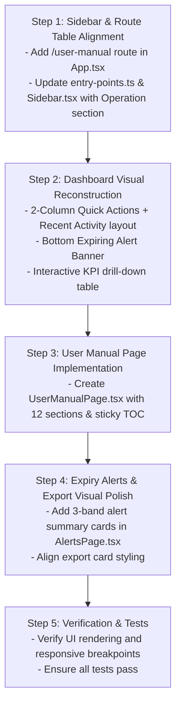

# SPEC-18 — Figma v3 UI Layout and Component Alignment

**Depends on:** SPEC-01 through SPEC-17.  
**Source:** `figma_code-v3/src/App.tsx` and UI reference screenshots.  
**Status:** **Implemented**. All 5 implementation phases complete and verified.

---

## 0. Overview & Audit of Pending Visual Changes

While styling tokens were added in SPEC-14 and copy was standardized in SPEC-17, several structural layout patterns, navigation hierarchies, and missing components from Figma v3 remain to be implemented in `@mou/web`.

### Identified Gaps from Visual Audit

| Component / Page | Current Implementation | Figma v3 Specification |
|---|---|---|
| **Sidebar Navigation** | Flat list of 10 routes; separate Export Excel / Export PDF; missing Operation section | Grouped navigation: 9 primary items + **"OPERATION"** section divider + **"User Manual"** item with book icon |
| **User Manual Page** | Missing from `@mou/web` | Full 12-section manual at `/user-manual` with sticky TOC sidebar, step badges, tips, warnings, and FAQ |
| **Dashboard Layout** | Full-width table + 3-column "Choose a Task" list | 3-tier layout: (1) Interactive KPI row with drill-down, (2) 1/3 Quick Actions + 2/3 Recent Activity grid, (3) Bottom Expiring MoUs alert banner |
| **Dashboard Quick Actions** | Plain white task cards | Styled action list: `Add New Company` (primary solid blue), `Expiry Alerts` (amber tinted), and standard white action cards with chevrons |
| **Dashboard Alert Banner** | None | Persistent bottom glass banner with alert icon, expiring count, and "View Expiring MoUs" button |
| **Expiry Alerts Summary** | Dropdown filters only | Top threshold summary cards (`Critical ≤ 30 days`, `Warning 31–60 days`, `Notice 61–90 days`) |
| **Navigation Labels** | `Zone Wise Dashboard`, `Upload MOU PDF`, `MOU Expiry Alerts` | `Zone Dashboard`, `Upload MoU`, `MoU Expiry Alert`, `Export` |

---

## 1. Detailed Screen-by-Screen Requirements

### 1.1 AppShell & Sidebar Navigation
* **File:** `src/web/src/components/layout/Sidebar.tsx`, `src/web/src/dashboard/entry-points.ts`, `src/web/src/App.tsx`
* **Navigation Items Structure:**
  1. `Dashboard` (`/`) — Icon: `grid`
  2. `Add New Company` (`/companies/new`) — Icon: `plus`
  3. `Existing Company` (`/companies`) — Icon: `building`
  4. `Edit Agreement` (`/agreements/edit`) — Icon: `edit`
  5. `Upload MoU` (`/upload-mou`) — Icon: `upload`
  6. `MoU Expiry Alert` (`/alerts`) — Icon: `bell`
  7. `Agreement History` (`/agreements/history`) — Icon: `history`
  8. `Zone Dashboard` (`/zones/overview`) — Icon: `map`
  9. `Export` (`/export` / `/export/excel`) — Icon: `download`
  10. **Section Divider:** `OPERATION` (`text-[10px] font-bold uppercase tracking-widest text-[#F26522]`)
  11. `User Manual` (`/user-manual`) — Icon: `book`
* **User Profile Footer:**
  * Displays user avatar initials, user name (`admin`), role (`ADMIN`), and logout button.

### 1.2 Dashboard Page (`DashboardPage.tsx`)
* **File:** `src/web/src/pages/DashboardPage.tsx`
* **Tier 1: Interactive KPI Cards**
  * 5 KPI tiles: `Total Companies`, `Active MoUs`, `Expiring Soon`, `Expired`, `Pending Review`.
  * Clicking any tile toggles an inline drill-down table below the KPI row with columns: `#`, `Company`, `Zone`, `Plant`, `Scheme`, `MoU Code`, `Expires`, `Status`, and a `✕ Close` button.
* **Tier 2: 2-Column Split Layout (`grid grid-cols-1 lg:grid-cols-3 gap-6`)**
  * **Left Column (`lg:col-span-1` — Quick Actions):**
    * Card containing vertical stack of action items:
      * `Add New Company`: Primary blue filled background (`bg-[#1B5FAE] text-white`).
      * `Search Company`: White background, blue icon.
      * `Edit Agreement`: White background, blue icon.
      * `Upload MoU PDF`: White background, blue icon.
      * `Expiry Alerts`: Amber tinted background (`bg-[#FFF0E8] border-amber-200 text-amber-800`), dynamic count `${expiringSoon} MoUs expiring soon`.
      * `Agreement History`: White background, blue icon.
      * `Export Data`: White background, blue icon.
  * **Right Column (`lg:col-span-2` — Recent Activity):**
    * Card with header `Recent Activity` and orange `View all →` link to `/agreements/history`.
    * Table columns: `Company`, `Zone`, `Plant`, `Scheme`, `Status`, `Updated`.
* **Tier 3: Bottom Expiring MoU Banner**
  * Full-width glass alert card (`glass-alert rounded-xl p-4`):
    * Orange alert icon + bold text `${expiringSoon} MoUs expiring within 30 days` + `Review and initiate renewals to avoid compliance gaps.`
    * Orange CTA button: `View Expiring MoUs` $\rightarrow$ navigates to `/alerts`.

### 1.3 User Manual Page (`UserManualPage.tsx`)
* **File:** `src/web/src/pages/UserManualPage.tsx` (Route: `/user-manual`)
* **Layout:**
  * **Left Sidebar (TOC):** Sticky navigation sidebar listing all 12 sections with smooth scroll navigation and active highlight.
  * **Header Hero Card:** Book icon, gradient badge, system title, and scheme pills (`NAPS`, `NATS`, `WILP`, `BVoc`, `DVoc`, `FLEXI`, `MSBTE`).
  * **Content Sections:**
    1. `Overview`: Platform purpose and scheme list.
    2. `Dashboard`: KPI tile meanings, recent activity feed.
    3. `Add New Company`: 4-step wizard guide (Company, Commercial, Payroll, Review & Save).
    4. `Existing Companies`: Profile tabs (Overview, Commercial, Payroll, History, Documents).
    5. `Edit Agreement`: Reason selection, proof upload, amendment lifecycle.
    6. `Upload MoU PDF`: Post-creation document attachment guidelines.
    7. `MoU Expiry Alerts`: 30/60/90-day alert bands and renewal workflows.
    8. `Agreement History`: Version diffs and audit logs.
    9. `Zone Dashboard`: Geographic breakdown and Scheme matrix.
    10. `Export Reports`: Excel workbooks and scoped PDF documentation.
    11. `AI Chatbot`: Multilingual assistant features (reference documentation).
    12. `FAQ`: Common questions on multi-scheme registration, expiry, code format, file formats.

### 1.4 Expiry Alerts Page (`AlertsPage.tsx`)
* **File:** `src/web/src/pages/AlertsPage.tsx`
* **Top Metric Summary:**
  * Add 3 alert summary indicator cards above the filter bar:
    * `Critical (≤ 30 days)`: Red border & badge (`#EF4444`).
    * `Warning (31 – 60 days)`: Amber border & badge (`#F59E0B`).
    * `Notice (61 – 90 days)`: Blue border & badge (`#3B82F6`).

### 1.5 Export Reports Page (`ExportExcelPage.tsx` / `ExportPdfPage.tsx` / Unified Export)
* **File:** `src/web/src/pages/ExportExcelPage.tsx`, `src/web/src/pages/ExportPdfPage.tsx`
* **Report Cards Grid:**
  * `MoU Summary Report`: Excel workbook with 4 sheets.
  * `Expiry Report`: Filtered Excel export.
  * `Bulk MoU Documents`: Download signed PDF archives.

---

## 2. Implementation Checklist

### Step 1: Sidebar & Shell Alignment
1. Update `src/web/src/dashboard/entry-points.ts`:
   * Add `user-manual` entry point (`roles: ALL_ROLES`, `path: "/user-manual"`).
   * Update nav labels: `Upload MoU`, `MoU Expiry Alert`, `Zone Dashboard`, `Export`.
2. Update `src/web/src/components/layout/Sidebar.tsx`:
   * Render `OPERATION` section header above `User Manual`.
3. Update `src/web/src/App.tsx`:
   * Register route `<Route path="/user-manual" element={<UserManualPage />} />`.

### Step 2: Dashboard Page Reconstruction
1. Update `src/web/src/pages/DashboardPage.tsx`:
   * Add active KPI selection state and drill-down table toggle.
   * Restructure middle section to 1/3 `Quick Actions` (styled with primary blue for Add Company and amber for Expiry Alert) + 2/3 `Recent Activity`.
   * Add bottom `glass-alert` banner with "View Expiring MoUs" button.

### Step 3: User Manual Component
1. Create `src/web/src/pages/UserManualPage.tsx`:
   * Port all 12 manual sections, TOC sidebar, callout components (`Tip`, `Warn`, `Step`, `Field`, `SectionHead`), and scheme reference cards.

### Step 4: Expiry Alerts Polish
1. Update `src/web/src/pages/AlertsPage.tsx`:
   * Add the 3 threshold summary cards (`Critical`, `Warning`, `Notice`).

### Step 5: Test Verification
1. Run `npm run check-types` and `npm run test` to guarantee zero regressions.
